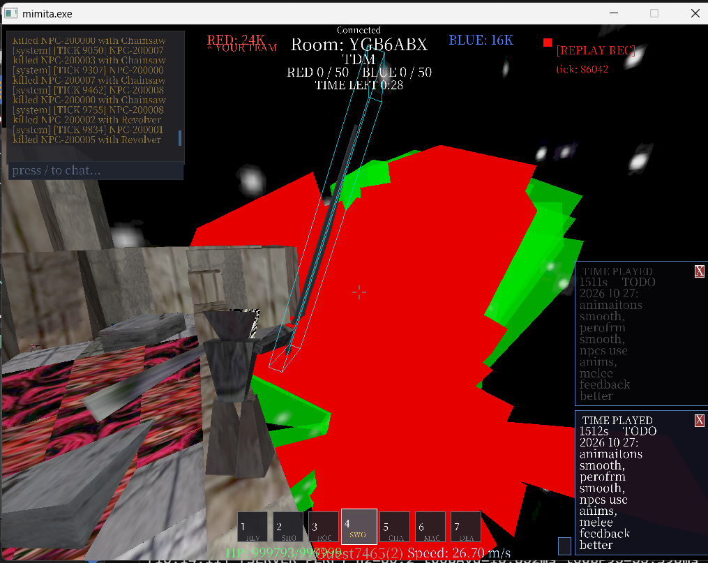
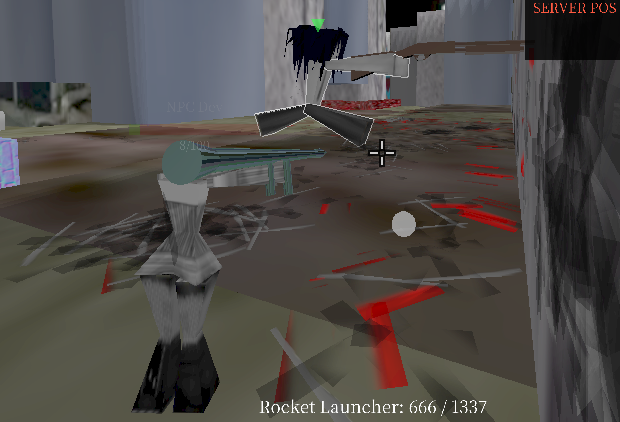

2026 10 29 1121 npcs are pahsing into the ground  after eth solid checking fixes 
oon dust2cyberiav4 map
no phaseing no no no no hpasing 
theres 2 whole npcs that are just stck in the grund on teh map rigt now i saw 

2026 10 29 1054
melee hit rexogntion nees more work
we need to make it like
melee
if i get a hit claim then i do it but idk 

then it does dmaage to them
but 
i wish it was just hitbox actual hitbox to hit the melee idk 

also, we need to make it so like we keep doing more 
master json lists
e.g. behavior profiles and roles nad stuff
those are confusing to em right now
so i want to do taht 

2026 10 29 0911 
need mega chainsaw
or chainsaw 
for chasinaw boss
bc chainsaw boss is epic but needs a bigger one

also final boss for zombie tower isssss?
idk
 i want like 10 bosses
 idk ill make some ove itme 
 matbe 

madness ocmbat mode 

2026 10 28 0958 jorj  ok smallest thing ever but the +1 in tdm mode  iti is not aligend right, 
and also my team keeps winnign all the time idk why
evne when i do  nothing
i think i tshoudl be more balanced?
ALSO ROCKET LAUCNEHR
we c
we need better rocket launcher visuals
we need better 
like we can literallt so do that we should just do that its so quick
but i need to be doing monster anims and zomb tower making idk whatrver 

2026 10 28 0850 jojr todo 
nooooo spotif streams nto so much 
tis ok 
 win some lose some

 ok whatst the deal
 animations
 when aniamtison are running just for me its fine liek cuz npcs freeze still which n to good
 but

also thi game si suepr fun 
and 
melee needs better visual feebdack like  
who am i even htiting and who am i getting hit by cuz i dont know 
but 
its super fun its super cool 
Theyre super fun, theyre super sweet

but fps dips stillllllllb ro why 
its cuz animations
when u do aniamtins
the animatosn i think are doing it and matb something to do with hot reload bc its consistent choppinesss
but then it doesnt suck
when its just me ?
WEAPON COLLISIONS THAT TOO
WHATTTTT
MACE WHEN COLLDIING WITH WORLD BIG ISSUES
MABYE ITS WHEN THE NPCS COLLDIING WITH WORLD THEIR COLISIOSN maybe we reallt do need better colisions idk 
2026 10 28 0854 build 3617 i think 
collisiosn overall just  ueghhhhhhhh
the mace collisions sucking 
bc i get stuck on edges
me as the character too getting stuck on edges of surfaces
whats the deal
how do we do liek internal rounding 
or 
how do we just get nice enough colisiosn that we dodnt get stuck bro WHY ugh. 

2026 10 27 1604
collisiosni think need work
cuz
npcs in the dust2cberiav4 map 
afet niaitons the npcs are getting caught like inside of walls
so 
better collisions, make blocks solid i thnk we should jsut do that if that mkes collisions stronger
but
also npcs need 
idk

i would like total accurat eh tboxes, so prob jsut do 2 modes
for now the mode for npcs i think should be like r
hmm
approximated? their weapon pos and their pos like capsules etc 
and that swhat we check collisions with

plr vs plr i would like real triangle vs triangle but idk 
matbe if we can do triangle vs triangle then we can skip capusle i love to skip capsule

blade radius and stuff idk i d ont udnerstand it in the ewpaosn configs 

swordsword is old, need to make it have config like chainsaw or mace those ar good new ones 
missing blade rdaius and stuff 
need that stuff to be visible as well 



2026 10 27 1614 idk what the prorblemis but plr otulines are massive
and not on plauers at all
thatmigiht be it?
idki was abt to be like how come it wont update live  but it probablt is and then it just not aligned to the actual actor models 

2026 10 27 1549

weapon collisiosn not good with the new animations , like the chainsaw i have it enabled and visible but i walk into the wall but then i dont get pusehd out of the wall, i juts phase thru it, need to keep weapon collisiosn working
as well as npcs i dontthink are using animaitons either i want to ensure all actors use the animations like how i do, if its a general like normla boy/girl avatar 
 
as well as log like what is goign wrogn  in the dev loop how come it wont just launch and work 
well now it works idk  2026 10 17 1513 

need to be able to edit the speed or snappiness of some animatiosn, some are intended to be as soon as upress teh key, the anim ahppens
as well as weapon anims chainsaw i tihnk are not going right, priorities might be off idk 

as well as big wireframe sisues  like idk whats wrong but when u do tests  the monter spawns or avatts have huge avatr wireframes 

weapons , all weapons should be able to colldiew ith actors as well, and do knockabck ,likeu cannot pass the chainsaw or other weapons thru actors, they should collide with the actors at least their capsule, id like their pure triangles to collide with the weapons but capsule is ok 

u are launching the game by doing like create socket and stuff, anda that stuff is working, loko into how the dev loop script works and if that is out of this scope then sa that but if u can make it so dev loop launches tehway that u are doing it bc it doenst haev lag it doenst have issues it just launcehs and thats good 

also: melee contaacts need to have a dynamic light show every single time, and do it like tihs 

tick 1 of contact = white spehre like 0.5m diameter spehre, 0.5 alpha, bigger and more alpha when hitting harder

base = 0.5 diameter, 0.5 alpha, 123,123,123 color
max force = 1.0 diameter, 1.0 alpha, 255,255,255 color

tick 2 of cotnact = white sphere disappears, replaced with 
this spark effect png
"C:\mimita-v9\assets\textureshq\sparkv3.png"
"C:\mimita-v9\assets\textureshq\sparkv2.png"
"C:\mimita-v9\assets\textureshq\sparkv1.png"

tick 2 thru 6 = spark v1
tick 7 thru 13 = spark v2
tick 14 thru 20 = spark v3

client sided tick rate as well
all sparks configurable alpha and configurable random rotation
prob add to  C:\mimita-v9\config\impact_decals.json this 

that is written in  C:\mimita-v9\docs\specs\animations\animations.md

also confirm that proiroities are working? like

like i want to know that  i can edit the json  and make it so  i can make it so 
damage is hihger priorities than walking or idle or jmping etc
and then, clips or animations have like 
modes like 
some animations must full yplay out like death
some animatons only need to play for N ticks such as damage, prob make the default 1, like u must be inthat anim for N ticks but the ticks amountis just 1 so its fine 

and some anims are total instnat overridable at all 
mace does need an attak cooldown like 1.0 sec fo rnow, or 60 client ticks so its not frame based 

idle needs to be totally the last priority bc someitms the atttacks or other things are overwriting it 
as well as if this is in scope  C:\mimita-v9\config\camconfig.json this keeps getting overwritten idk why 
ainmiatiosn needt o clear if i dont hav the weapon equipped, like if 
also not sure whats the deal with melee like i will hit them and it wont do damage, sometimtes it will, idk whats wrong 
idk if thtey do sweep collisions or there si a hidden delay, all weapons melee weapons by default should be active like all the time , attack 1x per tick that is the default that is for all melee weapons 

still there is perofmance issues 
launched last successful build 3494
Journal  : C:\mimita-v9\logs\2026-10-27\20261027_191214\events.jsonl
View     : build-or-la

in this events jsonl maybe idk 
and per aniamtion clip need to make the root location thing ,like the falling/landing makes me bounce up a lot so need to ahve that for those aniamitons speicifcally 
loike unequipping a weapon mid animation needs to return back to idle or next prioritiy in teh anim priorities 
maybe its bulilding as time goes on or more deaths? idk we need to trace 
dashing animation needs to happen like instantly like a ssoon as u do the dassh it should play the anim for the torso and legs and stuff , if u have wepaon equipped, else/no weapon means jus do full dash anim
same for dwn dash and  freeze and all the other animations 

C:\mimita-v9\config\animations.json also we need to make sure that the poses per anim 
like is it here or not?
like for the swordsword slash anim, i want to be ableto pose the weapon per part of the pose, like, the slashing of the left mouse button ddown for this weapon i want to rotatet teh weapon so that it is aligned correct in the engine 
performance issues are a big deal still  it sas im at 280 340 avg fps  and its like  0.3 0.5 cpu ms with 1.5 2.0 ms unaccounted max  but still im feeling  like 
its feeling like 30 fps its a issue that is liek outside of it that the perf_report isnt catching 

idle when u are in air 
we should make it so weapon vs weapon contaact at all, like, mace vs revovler, rocket launcher vs swordsword,  shotgun vs shotugn  weaponsn contacts do the melee contact thing every time as well too 

performance issue doesnt ahppen when i just join a sandbox match alone no npc 
we need to super look into like
how much mimita processes are running at once i think that is the problem bc i went into tsk manasger and closed lke 3 mimita processes then launcehd a new one with deev loop and hte fps issues stopped i think?
yeah it totally stops when u close the other mimita processes
need to make it so  that like they just dont stay open thats not good 

animations: jump over fall, fall over idle, in air over idle, etc, idle need to be the low lowlowest, always an animation happening , right now i will be in the air and just idle frozen not good, i want to be in an animation like as much a possible 

the fps issue happesn mroe and more as i have melee killing ppl killing npcs 

## Implementation update — 2026-10-28: collision, rockets, deathball

- **Solid geometry (top priority): implemented first-pass fixes; runtime feel
  still needs review.** Walkable ramp/edge seams now use a relaxed seam
  threshold and a wider contact tolerance in the actor-triangle path; the
  server NPC world no longer re-decimates already-unioned collision triangles;
  NPC spawn/respawn uses safe standing resolution; and server NPCs recover a
  root that ends up inside solid geometry. Runtime TDM evidence recorded
  repeated `npc.capsule.recovered` events and a player rollback. The `tdmtest3` ramp
  spawn/seam, block edge, sphere, and persistent-penetration scenarios still
  need live player and NPC traversal review.
- **NPC collision scope:** documented in
  [`../architecture/collision/collision.md`](../architecture/collision/collision.md)
  as capsule-now / triangle-later. Capsules are the accepted current cost/feel
  tradeoff; full animated NPC triangle collision remains a later target.
- **Future: accelerated per-tick NPC inside-solid query.** `funworld3` has about
  44,214 collision triangles, so the original unconditional
  `worldPointInsideSolid` call for every NPC every tick cost about 50 ms and
  dropped the listen server to 17–19 Hz. The current fix caps deep checks to one
  staggered NPC per tick, triggers them from stuck state or a low-frequency
  fallback, applies a 120-tick per-NPC cooldown, and uses the broadphase ground
  query instead of the full multi-candidate safe-spawn search. A 9-NPC
  `funworld3` run returned to roughly 60 Hz in most windows. If per-tick
  penetration detection becomes necessary, add a chunk-DDA/AABB-tree
  accelerated ray query instead of scanning every triangle. Occasional
  multi-hundred-ms NPC navigation spikes still exist separately from this
  inside-solid scan and need their own profile.
- **NPC rockets in TDM:** authoritative NPC projectiles now carry
  `weaponDefNetworkId`; the unused local `gNpcRocketState` path was deleted;
  non-exploding lifetime removals send a terminal despawn; and the client
  rejects stale state-recovery ghosts. Runtime TDM evidence showed NPC rocket
  spawns with `weapon_def_network_id=8`, deathball spawns with `=27` and
  pass-through enabled, repeated `server.projectile.terminal` events, and zero
  `client.projectile.state-recover` events.
- **Deathball damage:** the server damage branch now resolves the real
  `deathball` definition instead of falling back to a solid rocket, and
  `deathball.wall-pass` records the 3x lifetime decay. A live player/NPC hit
  scenario is still required to confirm edge/center damage and knockback.
- **Rocket Launcher visuals:** the supplied model, smoke sprite, explosion
  light, explosion mark, and surface-aligned shockwave are wired through the
  shared projectile/explosion owners; the red explosion sphere is unchanged.
  Added `rocket_preview 0|1` for live JSON inspection. Visual acceptance is
  still required.
- **Animation-driven bounce:** body-part-driven root push is damped to 25% of
  the configured response while weapon contacts keep the full rebound. The
  frozen `config/collision.json` values (`maxSpeed: 50`, `strength: 0.35`) are
  unchanged. A hot-reloadable `limbBounceMode` switch now selects `2` (damped
  limbs, default) or `1` (legacy full limb bounce).
- **Ragdoll limb limits:** head and arm attachment cones/rotation ranges are now
  bounded instead of effectively unlimited; leg limits are unchanged.
- **Weapon config order:** `devscripts/weapon_json_sync.py --check` now fails
  out-of-order top-level fields, and `--reorder` preserves JSONC comments and
  existing values. All 34 per-weapon configs now match masterlist order.
- **Client/server-only directive:** added to
  [`networking/networking.md`](networking/networking.md) and cross-linked from
  [`../architecture/code-ownership/code-ownership.md`](../architecture/code-ownership/code-ownership.md);
  prefer deleting local/offline gameplay paths once the client/server owner
  exists.
- **Deferred feature ideas:** melee-focused mode changes, projectile
  revolver/shotgun experiments, heavier movement mode, and weapon-clash feedback
  remain tracker-only in this pass.

## New intake — 2026-10-27: networking and mode-start reliability

- **Connection attempts, mode starts, and NPC Waves starts are timing-dependent.**
  Observed/possible stages: connect, coordinator lookup, ICE/TURN, join, map
  ready, mode start, NPC Waves start, reconnect. Exact build, PID, room code,
  and journal are unknown for the earliest reports. Desired behavior: every
  attempt ends in success, rejection, timeout, or cancellation with a recorded
  stage and reason; the client shows Connected/Reconnecting only from actual
  packet freshness; a managed mode starts only after required clients are
  active and map-ready; NPC Waves starts with the expected wave number and NPC
  target. Current source leads, not confirmed causes: join retries can create
  duplicate players because the server deduplicates by reconnect token while
  the client re-sends the same join token; coordinator token validation runs
  synchronously in the server packet path; managed matches can advance from
  boot intermission before any client is active; NPC Waves begins wave 1
  without checking for a human; killed wave NPCs may respawn; reconnect token
  rotation may outlive the client retry window. Status: UNRESOLVED / CAUSE
  UNCONFIRMED.
  [`networking/networking.md`](networking/networking.md),
  [`dev-loop/dev-loop.md`](dev-loop/dev-loop.md),
  `config/gamemodes/npc_waves.json`,
  `src/network/multiplayer-packets.cpp`,
  `src/network/connection-health.cpp`,
  `src/network/coordinator-client.cpp`,
  `src/network/server-gamemode.cpp`

  2026-10-28 implementation update: bounded `network.connect.stage` and
  `network.session.health` evidence was added. Retried joins now reuse the
  existing player/session, managed modes wait for an active client, NPC Waves
  waits for a human and uses one-life wave actors, the safe-spawn probe is
  bounded with an explicit authored-spawn fallback, and the server keeps the
  previous reconnect token valid through the client retry window. Runtime
  evidence exists for TDM launches, NPC Waves launches, and a relay-only TDM
  launch (builds 3606/3607/3617/3621/3624); the full repeated-launch matrix
  remains UNRESOLVED and CAUSE UNCONFIRMED for any remaining failures.
  [`../changelog/2026-10-28/20261028_125325-networking-reliability.md`](../changelog/2026-10-28/20261028_125325-networking-reliability.md)

## New intake — 2026-10-28

- **NPC tick-locked animation, visibility categories, and admin commands:**
  Added 2026-10-28 (latest session). Implement an opt-in
  `avatar.json.animation_profile.npcTickLocked` mode that advances one authored
  tick per fixed simulation tick for NPC actors only; keep player and unset NPC
  profiles unchanged. Extend the existing live capsule issue instead of adding
  another one. Make `entity_visibility` the local viewer’s off-by-default master
  switch with independent actor-capsule, weapon-hitbox, NPC-position, and
  map-object categories that draw through walls. Add server-authoritative
  `admincmds 1|0`, `player_list`, `admincmds_grant N`, and `admincmds_revoke N`;
  the host starts enabled, grants last only for the session, and every existing
  host command uses the same access gate. Runtime/visual acceptance remains
  separate from build evidence.

- **Design secure autonomous AI access for Stripe monitoring and incident
  response:** The player wants an AI to check Stripe and related service health
  autonomously so it can notice and respond to problems faster than waiting for
  a person. Design a narrowly scoped, auditable access path that starts with
  read-only account activity and alert review, limits data to what triage needs,
  and keeps credentials in an approved secret store rather than prompts, source
  code, or general-purpose agents. Explore whether a small set of predefined,
  high-confidence containment actions can be pre-authorized for rapid response;
  separate those from sensitive actions such as refunds, payout changes,
  settings edits, and API-key rotation, which need explicit approval or a
  separately approved runbook. Define alert thresholds, action limits, audit
  records, notification, rollback/recovery, and false-positive handling. Prove
  the flow in test mode or a simulation before enabling live-account access.

## New intake — 2026-10-27

- **Make AI build instructions unambiguous and keep the issue tracker easy to
  sort:** Added 2026-10-27 (19:00Z). The player wants agent-facing project
  documentation to make the persistent dev-loop the clear path for live builds
  and launches, and to explain when older build commands are wrappers or
  internal steps. A recent build attempt showed no compiler processes and no
  `build/mimita.exe`; running `python build.py` then printed shader-link
  messages without a clear final build result or artifact location. This is
  user-provided evidence of confusing feedback, not proof of the build's cause
  or outcome. Clarify the canonical command, status/control path, artifact
  selection, and how to recognize a completed/failed build; align examples and
  agent guidance with the existing dev-loop authority. Keep tracker intake
  entries in reverse chronological order (newest first), with a clear
  first-observed/added timestamp; leave any priority ranking ordered by impact.
  Longer term, migrate the tracker to an editable spreadsheet with unique IDs,
  timestamps, short summaries, details/reproduction steps, linked evidence,
  priority, and status, while preserving evidence and sort/filter by recency
  and priority. No spreadsheet or documentation migration has been made yet.

- **Melee input is ignored while airborne:** The player reports that
  SwordSword and Chainsaw do not work while in the air, and recalls the same
  problem with SwordSword previously. Clicking in the air produces no slash,
  heavy slash, sweep, defensive pose, chainsaw rev, or mace swing. Expected
  behavior is that every melee weapon can be used in the air by default; this
  must not be a temporary exception. Source finding: `MeleeAction::actorState`
  defaults to `Grounded` in `src/combat/weapon-melee-config.h`, the SwordSword,
  Chainsaw, and Mace actions omit `actor_state`, and
  `MimitaMelee::resolveAction()` filters actions by the airborne state in
  `src/combat/melee-client.cpp`. The server attack and continuous-contact paths
  do not reject airborne actions. This entry records the report and source
  finding; runtime confirmation and human acceptance remain open.
- **Every weapon needs a deliberate weapon-collision entity shape:** The player
  wants every weapon/object/entity to have a weapon collision entry. If no
  authored box exists, the actual model collision should be used. `nothing` is
  the only weapon allowed to have zero hitbox. Current
  `config/weaponcollisions.json` has entries for only 12 of the 34 top-level
  weapon IDs. Missing IDs include `aa12`, `admin_revolver`, `big_shotgun`,
  `bomb`, `captain_falcon_moveset`, `darkbang`, `deathball`, `fire`,
  `force_punch`, `frag`, `godball`, `hafs`, `nothing`, `op_revolver`,
  `quick_hit`, `smoke`, and all six zombie claw weapons. Missing entries fall
  back to a generic hand capsule in `WeaponCollisionJsonConfig`, so no-model
  items do not receive a deliberate entity hitbox. This is a configuration and
  collision-ownership request, not yet a verified runtime defect.
- **Check suspected high VPS disk usage:** The player suspects the website VPS
  may be around 95% full and says that level is concerning. This figure has not
  been independently measured, so record it as a lead rather than a confirmed
  outage or capacity incident. Run the documented read-only VPS audit and
  capture `df -hT` and `df -i`, then identify the largest top-level filesystems
  and directories with bounded, same-filesystem usage checks. Compare the
  results with service needs, database backups, and the VPS storage policy
  before proposing cleanup; do not delete files merely to reclaim space.
- **Explore a fun online browser game for the website:** The player wants more
  games and playful experiences on the website, starting with a simple online
  2D or 3D game such as Bomb Tag. They are also curious about decentralized
  browser networking, possibly peer-to-peer play. Treat this as an exploratory
  product idea, not a selected architecture: define a tiny first playable loop
  and assess room discovery, connectivity/relay fallback, authoritative game
  state, abuse prevention, browser support, and hosting/storage costs before
  choosing a networking model.
- **Respond to Stripe's Node.js security warning for MiMITA:** Stripe's
  authenticated October 23, 2026 email says telemetry over the previous seven
  days indicated the MiMITA Stripe account's environment may use an outdated
  Node.js version; it does not establish compromise. The email names account
  `mimita-v1` (`acct_1U05r0GvytRPXxx5`) and advises updating Node.js, reviewing
  server logs and Stripe activity, and rotating API keys. The Node.js project
  advisory currently lists patched releases 22.23.4, 24.22.1, and 26.12.1
  (security release dated October 21, 2026); recheck the current advisory and
  deployed runtime before acting. First perform read-only host/runtime/log and
  Stripe Workbench activity reviews, preserving evidence. Then, as an
  intentional production change, patch the existing Node major to a tested
  patched release, verify API/database health, create and deploy a replacement
  least-privilege Stripe key, verify successful requests, and expire the old
  key. If suspicious use is found, contain and revoke the suspect key promptly.
  Neither live server review nor key rotation has been performed as part of
  this intake; do not describe the server as compromised without evidence.

## New intake — 2026-10-27: replay export and frame pacing

- **Replay/clip export fails in a live match:** Reported 2026-10-27 14:37 EDT
  (18:37Z; the attached screenshot file is timestamped 14:37:24 EDT). In room
  `SID6XXBP`, the game shows `Export Failed: Export subprocess failed (exit
  code 3)`. This is direct visual evidence that this export attempt failed, but
  the screenshot does not identify the export command/target, subprocess
  output, or journal, so the exit-code cause is unknown. Preserve the matching
  game build, export request, subprocess stdout/stderr, and run journal on the
  next attempt. [Screenshot](../evidence/replay/20261027_183724-export-failed-frame-pacing.png).
- **Character-controlled gameplay has severe frame pacing; Freecam feels
  faster:** The player reports very poor performance while controlling their
  character, improved performance after entering Freecam, and poor performance
  again on returning to character control. They noticed choppiness after
  animations were added, but are unsure whether it began around 09:00 today;
  14:37 is when they were actively noticing and working on it. This timing is
  uncertain and does not establish animations as the cause. The attached HUD
  shows `FPS AVG: 38`, `MAX: 6503.84ms`, `PHYS: 48.94`, and `CPU: 1091.84ms`;
  subsystem timing rows show different values, so this is a screenshot sample,
  not a coherent controlled profile or frame-time distribution. Compare
  Freecam and character control on the same build, map, view, and actor state;
  capture frame-time percentiles and render/animation/update scopes across both
  transitions. [Screenshot](../evidence/replay/20261027_183724-export-failed-frame-pacing.png).

## New intake — 2026-10-26

- **Dev-loop TDM launch fails before server logger readiness:** Build 3368
  published successfully, but two `tdm npc elite` launch requests timed out
  after 20 seconds while the server process was alive and no `logger.started`
  event appeared. Build 3369 was also published; its TDM launch was still in
  `launching_server` with no ready server or client at the last status check.
  The server's legacy text log showed gameplay was already running, while the
  shared journal had no server event. A closed 2.2 GB legacy text log pushed
  the `logs` tree above the structured logger's 1 GB quota, and the quota
  pruner only considered completed run directories. That log was preserved in
  `.dev/archived-logs/2026-10-26/`; the tree then measured about 322 MB and
  build 3369 launched both server and client. The pruner now also considers
  closed legacy text logs. Build 3371 launched successfully with server and
  client journal readiness in Payload mode. Runtime proof of the pruner's
  over-quota branch and TDM avatar gameplay remains open. This is separate
  from the stale displayed launch-mode issue below.
- **TDM NPCs stop shooting after one NPC is killed:** The player reports
  surviving NPCs stop shooting at them after the player kills one NPC. This
  has not been reproduced and does not establish whether targeting, combat
  state, NPC replacement, or another event is responsible. Reproduce in a
  confirmed TDM run and compare surviving NPC target acquisition, legal-shot
  decisions, accepted shots, and state changes immediately before and after
  the first NPC death.
- **TDM NPCs sometimes do not acknowledge or attack anyone:** The player
  reports that while walking close to NPCs, they sometimes do not notice or
  attack the player; at other times the NPCs appear not to attack anyone. No
  trigger is known. The player says the session journal shows the behavior but
  did not identify its path or run ID; the available 2026-10-26 journals
  inspected for context are Payload or Sandbox, not a confirmed TDM
  reproduction. Capture the exact TDM run and compare NPC state, target and
  visibility/team eligibility, target acquisition, legal attack decisions,
  attack requests, accepted damage, and nearby actors' behavior. Keep this
  separate from NPCs stopping after a teammate death until evidence shows they
  share a cause.
- **TDM start appears to overwrite `config/camconfig.json`:** The player reports
  that their camera settings are overwritten whenever a new TDM starts. Desired
  behavior is for `camconfig.json` to remain the persistent core baseline,
  gamemode values to act as temporary match-scoped overrides that restore the
  baseline afterward, and console changes to be the most temporary layer. The
  player notes that console changes may currently fail when a gamemode has an
  override. Define and expose precedence for each setting, including whether a
  mode may intentionally block a console change, and make the active source and
  reason visible. Source inspection confirms a possible disk-rewrite path:
  `SettingsBackup::saveBackups()` copies `camconfig.json` to `.bak` before a
  community-match presentation override, and `CommunityMatchClient::reset()`
  restores that backup over the JSON file. The backup helper is triggered by
  any nonzero FOV, ragdoll, or blood override; TDM has an explicit ragdoll
  presentation setting. This explains how a TDM match can involve a `camconfig`
  backup/restore, but does not prove that the file is overwritten at match
  start. Compare file contents/hash and runtime camera values before match,
  during TDM, and after exit; inspect backup/restore events and mode FOV values.
  The `scm` and `settings_camera_smoothness` handlers in
  `src/camera/camera-commands.cpp` currently only print the supplied value and
  do not appear to apply it; identify which console command is failing before
  attributing that symptom to a gamemode override.
- **TDM NPC-versus-NPC kills do not show death ragdolls:** The player reports
  that when an NPC kills another NPC in TDM, no death ragdoll appears, while a
  player killing an NPC does produce one. The TDM specification and current
  `config/gamemodes/tdm.json` both say death ragdolls are enabled, so the
  expected result is a ragdoll for either killer type when the victim's death
  presentation is enabled. This comparison is user-reported and has not been
  reproduced from a supplied run journal. In a confirmed TDM run, compare the
  lethal damage/death transition and corpse-presentation request for NPC-vs-NPC
  and player-vs-NPC deaths, including victim life identity, resolved mode and
  global ragdoll settings, request result, and client presentation. Determine
  the first stage that differs before assuming the setting is ignored.
- **NPCs need nicer, more polished authored animations:** The player wants to
  experiment with a more expressive shared animation set for NPCs across avatar types:
  walking/running, crouching, jumping, airborne/falling/hovering, landing,
  aiming in/out, and different levels of hurt reaction. Explore choosing and
  blending these from movement/combat state while keeping AimBody and whole-body
  pitch/yaw aiming coherent. Assess how animation poses relate to physical
  parts and hitboxes so poses remain readable and predictable without making
  hit registration misleading. The existing animation spec already calls for
  one shared runtime and reusable clips for players and NPCs; first determine
  whether the current state machine and profiles can express this experiment.
  This is a design/playtest request, not a confirmed animation defect or a
  request to create a separate NPC animation path. **2026-10-28:** added the
  opt-in `npcTickLocked` profile mode for one-authored-tick-per-simulation-tick
  playback; runtime comparison against movement speed remains open.
- **Animation authoring needs a much easier, still hand-authored workflow:**
  The player wants animation creation to feel as approachable as the Map Editor
  made Payload map editing: substantially easier to make and adjust authored
  motion, potentially without directly placing keyframes for every pose. Explore
  visual pose editing, reusable motion building blocks, or another timeline-
  light workflow, while keeping the result intentionally authored and compatible
  with the shared animation format/runtime. These are ideas to evaluate, not a
  selected UI or implementation. The existing Blender exporter remains a
  keyframe/Action-based workflow; compare its friction with the player's goal
  before choosing what to simplify.
- **Replay export fidelity and crash investigation:** Reported 2026-10-26,
  with the replay issues dating back about a week (approximately 2026-10-19;
  onset is approximate). Export needs to work in fullscreen and windowed modes;
  show ragdolls; and match gameplay presentation, including sound cut/retrigger
  behavior and blood decals that stay in their intended world-space orientation
  instead of facing the replay camera. The player reports replay blood currently
  appears screen-facing. A crash report from 2026-10-26 records an uncaught C++
  exception with no exception detail or symbolized cause. Its recent-activity
  list includes repeated large `Rendering::ReplayActors::Actor` frame spikes
  (up to 403.8 ms) before the crash, making replay actor rendering a lead to
  investigate, not a confirmed cause. [Crash report](../evidence/crashes/crash_20261026_212548.txt).
  Compare the same capture in fullscreen and windowed exports; check ragdoll
  transforms, blood orientation/placement, and sound at replay start, cuts, and
  retriggers against the source gameplay. Preserve the game build, display mode,
  replay/capture, output video, and matching journal with each reproduction.
  Replay fidelity and the crash cause remain unverified.
- **Repeated position corrections at high speed above map geometry:** The
  player reports that moving far from map geometry at about 250 m/s causes
  repeated snapping each tick to a position above the general map area. The
  reported speed drops toward 10 m/s, after which the player can descend
  without further snapping. This ordinary-movement case is distinct from the
  previously journaled correction after an explicit teleport into blocking
  geometry. Reproduce while recording client predicted position/velocity,
  server accepted position/velocity, correction reason and magnitude, and
  collision contacts; root cause is unknown.
- **Dev-loop status shows stale journal or mode instead of the live run:**
  Reported 2026-10-26 09:39 EDT (13:39Z): while playing TDM, the dev-loop still
  showed the `duel_presentation` launch mode from a session started about 12
  hours earlier. In a later inspection, the displayed journal was run
  `20261026_145155`, whose server heartbeat reported Sandbox, not Juggernaut.
  The user wants the dev-loop to show the journal and active mode belonging to
  the current live client/server run, rather than an old journal or launch-mode
  label. This is a user report plus a verified mismatch in the inspected run;
  the cause is unknown. Trace status data ownership and refresh/update timing,
  then show the current journal path and authoritative live server mode
  distinctly from the launch profile. Validate across a mode switch and a new
  dev-loop run.
- **Juggernaut blood spray appears only after restarting the game:** The user
  reports that blood spray is visible in TDM but absent in Juggernaut even
  though `presentation.blood`, `blood_enabled`, and the shared blood settings
  are enabled. They report that restarting the game made blood work; the cause
  is unknown and restart is not yet established as the fix. Inspect the active
  run's mode presentation application, effect gates, and hit events before and
  after restart, then reproduce matched hits in TDM and Juggernaut.
- **Dev-loop launch latency target:** The user wants `mimita.exe` to launch
  within 1 ms of pressing `1`; this is an ideal target, not a measured current
  value or a confirmed achievable guarantee. Measure keypress-to-process-start
  latency across the dev-loop handoff, identify the longest delay, and reduce
  it while retaining correct build selection and live journal ownership.
- **NPC avatars need mode-selected groups and per-NPC respawn identity:** The
  player wants modes to select reusable NPC avatar groups from the gamemode
  masterlist and choose whether NPCs reroll avatars on death or keep one avatar
  per NPC across respawns. Desired TDM behavior is one stable avatar per NPC:
  NPC A remains A, B remains B, and so on; other modes may opt to reroll. Source
  inspection found NPC avatar selection currently draws from every valid avatar
  folder and seeds the selection with the transform epoch, while the mode
  avatar group is not consulted by that picker. This is a feature request and
  source finding, not a runtime reproduction.
  2026-10-26 implementation update: the shared NPC spawn finalizer now
  filters against the mode's `npc_avatar.group` and applies its
  `keep_per_npc` or `reroll_each_spawn` rule. TDM selects
  `competitive_no_headless` and `keep_per_npc`. Configuration validation and
  build passed; live TDM avatar verification remains open. The dev-loop
  logging blockage was resolved, and the current verified run is Payload.
- **Live NPC weapon-profile updates across roles and modes:** The player
  changed `config/behavior-profiles.json` so the selected NPC profile cycles
  only the revolver and shotgun. While editing the `balanced` profile around
  line 70 during play, the player reports that NPCs do not appear to change.
  They want profile edits to apply live to every NPC role in every gamemode.
  The cause is unconfirmed: trace the active config path, profile reload, role
  resolution, and when already-running NPCs adopt updates before changing the
  owner.
- **TDM join requires repeated attempts:** The player reports needing about
  nine join attempts before becoming able to play, rather than joining once
  and immediately moving around in the match. The attached screenshot shows
  several system messages for `Guest(6281)` variants joining the game; it
  supports repeated join activity but does not identify why it happens or
  whether each message is a distinct connection, retry, or player identity.
  Reproduce in confirmed TDM and trace the complete join path from request
  through server acceptance, roster/team assignment, spawn, and controllable
  gameplay. Record each attempt's client/server state and identity so the
  first failed or repeated step is clear.
- **TDM slope collision failure on `tdmtest3`:** After recent collision changes,
  the player reports falling through slopes while spawning into `tdmtest3`.
  They are unsure whether seam tolerances or another collision issue is
  responsible. Reproduce on the exact map and capture the spawn transform,
  loaded collision geometry, slope contacts, grounded state, and first
  position divergence. The supplied build 3371 journal is a Sandbox run on
  `funworld3`; it contains collision summaries but does not reproduce this
  TDM/map report. Seam tolerance or solidification changes remain unselected.
- **Map blocks may need automatic solid collision:** The player is unsure how
  blocks should become solid and proposes either making blocks solid
  automatically or providing a mode where that behavior is enabled. This is
  an open design question, not a decided global rule. Clarify which block
  types and modes should be affected, how collision is authored/validated, and
  whether existing maps need an opt-in migration before implementation.
- **Repeated position-correction snapping:** The player reports random
  position corrections that snap repeatedly, and suspects the journal may
  show a client/server disagreement. This may overlap the separate high-speed
  correction report above, but the current report does not give a trigger,
  map, or exact actor. Inspect the cited run for paired client prediction,
  server acceptance, correction reason/magnitude, and collision state; do not
  infer a network cause from the visual snap alone. The supplied build 3371
  journal is Sandbox on `funworld3` and has no movement correction event that
  establishes this repeated behavior, so reproduce the report with those
  owner-level records enabled.
- **NPC aim accuracy and movement feel:** The player wants NPC difficulty,
  movement, and firing speed to remain otherwise the same while NPCs become
  less accurate. They also want NPC movement to feel more developed. They are
  unsure whether behavior-profile JSON edits currently take effect live, so
  first verify the active config path and hot-reload/adoption behavior with a
  visible, attributable change. Then tune accuracy alone while preserving
  firing cadence and other difficulty settings, and investigate movement as a
  separate issue against the NPC movement owner and real scenarios. The player
  says they move much faster than NPCs and wants NPCs to combine the abilities
  available in their mode, including dash, down-dash, bunny hopping, and air
  strafing; TDM is reported to have these abilities, but NPCs use dash only a
  little and do not maintain comparable speed. Determine whether NPC intent,
  ability eligibility, sequencing, execution, or control difficulty causes
  the gap. The player prefers skilled, risky high-speed movement—even around
  500 m/s in competitive play—over a hard speed limit; that figure is an
  aspirational example, not a tuned target or acceptance threshold. This
  overlaps the authored movement repertoire in
  [`npc-behavior.md`](npc-behavior/npc-behavior.md), which describes dash /
  down-dash chains, rapid dash bursts, bunny hops, and air strafing; that spec's
  implementation status says current chance-based inputs do not yet provide
  authored, event-sequenced movement recipes. Verify the active TDM behavior
  and execution path before treating the designed repertoire as available in
  live play.
- **Gunshot audio should remain audible at long range:** The player reports
  that distant LMG fire can become inaudible around 50 m. Desired example
  attenuation: at 50 m, about 10% of the source volume; at 500 m, about 5%; at
  2,500 m, about 1%; and at 3,000 m, inaudible. Treat these as user-proposed
  targets to validate against the audio distance/falloff owner, not as
  measured current behavior or a settled curve. Check weapon-specific source
  levels and spatial attenuation before selecting interpolation and maximum
  distance.
- **World and entity collisions snag actors, including on block and sphere
  contacts:** The player reports getting caught on block edges, especially at
  the seam between the two steep spawn ramps on `tdmtest3`, and wants the ramps
  treated as one continuous object. They say the snag is noticeable while
  shooting. Scenario `devscripts/scenarios/user/scenario-20261026_190510-caught.jsonl`
  records a Sandbox capture on `tdmtest3` with 5,174 input frames and 231 frames
  with primary fire held/pressed, but records no collision contacts or stuck-
  state marker; it cannot by itself tie firing to a specific snag. In a later
  report, the player says they also got caught on a sphere and wants ordinary
  movement past solid objects to avoid catching. The sphere's map/object,
  collision shape, location, and run evidence were not supplied, so it is not
  yet known whether this shares a cause with the block-edge or ramp-seam snag.
  Reproduce each case separately and trace the first collision/contact and
  movement divergence. Do not assume joining the ramp meshes into one object
  is the correct fix before checking seam geometry and collision continuity.
- **Falling through map geometry on `tdmtest3`:** The player reports being
  able to pass through geometry and falling through the map. Scenario
  `devscripts/scenarios/user/scenario-20261026_191024-fallthru.jsonl` records
  Sandbox on `tdmtest3`, 5,883 input frames, and 2,875 frames marked
  ungrounded; it does not include collision contacts or prove which surface
  failed. Reproduce and capture loaded collision geometry, contact queries,
  grounded transitions, and the first position divergence. The suggestion to
  make blocks solid automatically remains a design hypothesis; first
  determine whether these map surfaces are missing collision or collision
  response is failing.
- **Repeated correction far outside world geometry:** The player reports
  repeatedly snapping back to a previous position when moving too far from
  world geometry, and wants to be allowed to fall through the void instead.
  This may overlap the existing high-speed correction report, but this report
  specifically asks that void movement not be pulled back to stale position.
  Reproduce with paired client-predicted and server-accepted positions,
  correction reason/magnitude, world bounds, and collision contacts; decide
  expected out-of-world behavior before changing correction policy.
- **Melee-focused modes and NPC melee combat:** The player wants modes built
  around swords and other physical melee weapons to make movement a larger
  part of combat, with NPCs able to use the same weapons. This is a distinct
  proposal from the existing Smash Bros-inspired arena mode. Weapon concepts
  and open decisions:
  - `swordsword`: intended as a strong basic sword, but the player reports it
    is not functional yet. 2026-10-27 decision: a single left-click slash adds
    a 3 m/s aim-direction impulse; the double-left heavy slash adds no impulse
    and deals 2x damage. Right-click is a sweep, and double-right holds a
    front-arc block that requires the sword to physically meet the incoming
    melee contact. The authoritative contract is now
    [`SwordSword behavior contract`](weapons/melee/swordsword.md).
  - `spyknife`: the model is reportedly missing and damage is inconsistent.
    Trace the model path and full authoritative damage path against the shared
    physical-contact contract in
    [`melee-weapons.md`](weapons/melee/melee-weapons.md), and determine whether
    it uses that reusable path or a separate special path before changing it.
    Backstab behavior is undecided because the player feels the game may be
    too fast for reliable backstabs.
  - `chainsaw`: close range and high damage; unlike the sword, it should not
    add the proposed attack impulse.
  - Mace, morningstar, bat, or hammer: a heavy windup followed by high damage
    and knockback, with a dedicated animation that could be procedural or
    Blender-authored. Whether attacking slows the user remains open.
  - `hafs` (“huge awesome freaking sword”): make the existing weapon work and
    remove its current slowing effect. The player proposes disabling dash and
    double jump while equipped while retaining freeze and down-dash; verify
    the current behavior and decide the ability tradeoffs with the weapon
    owner.
  - All melee items should be physical objects that can block attacks. On
    weapon-to-weapon contact, the player proposes angle/speed/force-dependent
    knockback to both actors and a spark effect. The momentum split and
    magnitudes, including the suggested fast-versus-stationary example, are
    illustrative only and need a collision, physics, and balance design before
    becoming requirements. The blocking proposal also needs reconciliation
    with the current SwordSword contract, whose defensive pose is animation
    only and does not block or reduce damage.
- **Map scale and enemy readability:** The player suspects maps that feel too
  large make enemies hard to see. They propose experimenting with roughly
  10-by-10-meter block-scale layouts or ensuring a point of interest or event
  about every 50 meters. These are design hypotheses, not fixed map rules.
  Enemies reportedly remain too small or hard to locate even when forced to a
  larger size. The player does not want a hard movement speed cap and thinks
  very high speed could be a competitive strategy if difficult to maintain
  and control; whether scale, sightlines, map rhythm, camera/readability, or
  familiarity is the main problem is unknown. Evaluate through map-authoring
  and live play experiments, connected to the existing Entity Editor and
  Blender-to-game live-edit/sync request. Treat both the 10 m / 50 m layout
  examples and 500 m/s speed example as hypotheses, not settled limits.

## New intake — 2026-10-25, 00:21 UTC

- **Event-driven completion for AI-run gameplay scenarios:** Running the game
  through a fixed long timeout (for example, 180 seconds) makes AI workflows
  such as DeepSeek wait even when the scenario's desired outcome has already
  occurred. Make scenario execution wait for meaningful game/runtime events
  and finish as soon as the configured success or failure condition is
  observed, while retaining a bounded timeout as a fallback for missing
  events or hangs. Define the supported stop conditions and how scenario
  results are reported. This is an intake item; implementation and exact event
  contract remain open.

## New intake — 2026-10-24, 20:15 UTC

Player report from the run presented as TDM mode 1 on `funworld3`:

- **TDM config and run identity:** `config/gamemodes/tdm.json` currently
  specifies five actors per team, a 30-point goal, a 180-second limit,
  10-second intermission, three-second countdown, five-second results,
  separate `red_spawn` / `blue_spawn` groups, visible health bars, and green /
  red player wireframes. This matches the requested defaults in the file.
  The supplied run does not prove those settings ran: dev launch profile 1
  (`current`) is configured in `devscripts/dev-launch-modes.json` with
  `--mode sandbox`, `--gamemode sandbox`, and `--no-npcs`. The journal also
  shows the final server arguments include those values and starts with
  `mode=sandbox`; the earlier `--mode melee` argument is superseded. Current
  dev-loop status identifies runtime build 3091 while build 3093 is latest.
  Select or configure a launch profile that uses `--gamemode tdm` and does not
  disable NPCs, then confirm the server journal says `mode=tdm` and records
  the intended executable before
  evaluating TDM phases, roster, scoring, spawns, or presentation.
- **NPC death followed by apparent server failure:** The player reports that
  killing an NPC is followed by a “last packet X seconds ago” indication and
  what looks like a server crash. In
  `logs/2026-10-24/20261024_192228/events.jsonl`, the client records
  `death.kill.enter` for `NPC Dev` at `2026-10-24T19:28:05.557Z`, with
  `actor_type=player`, `killer=void_death`, and Z = -500.08; another death
  event follows 50 ms later with an unknown killer. The launch arguments name
  the host player `NPC Dev` and include `--no-npcs`, matching the death record's
  `actor_type=player`; this does not show an NPC being killed. The server continues
  sending snapshots through `19:28:29.006Z` and logs another event at
  `19:28:30.530Z`. Dev-loop status later showed server PID 4808 alive and no
  client PID; at `20:08:00.883Z` its journal records a successful supervised
  server stop (`stopped=true`). The evidence does not show a server crash after
  the reported death. It does show the intended TDM run was logged as Sandbox,
  and the client death record is not an authoritative NPC kill record. Next,
  reproduce on the intended build and confirmed TDM mode, then correlate the
  actor's server-side death, score/respawn events, last server tick/snapshot,
  client disconnect, and process exit/stop result. Keep crash, server stall,
  and client/network disconnect as separate outcomes.
- **NPC aggression:** The player wants NPCs to engage more aggressively. This
  run has no TDM NPC behavior evidence (`npc_count=0` in the relevant server
  snapshot summaries), so it cannot identify a TDM profile or prove a tuning
  failure. First confirm the TDM role-to-behavior-profile selection and record
  target acquisition, first legal shot, accepted shots, weapon changes, and
  pursuit. Then tune the selected profile in JSON while preserving shared
  weapon cooldowns and legal attack rules.
- **Position correction around map geometry:** At
  `2026-10-24T19:25:51.299Z`, the dev-loop delivered the client command
  `teleport 73.639,20.781,355.618`. The server logged
  `movement.server-position-corrected` with reason `blocking-geometry` and a
  50.05 m correction; the client applied the authoritative position with a
  48.72 m error, then subsequent corrections were about 0.011 m. This run
  shows a correction after an explicit teleport into blocking geometry. It
  does not establish a correction during ordinary movement far from geometry.
  Reproduce the ordinary movement case separately and compare client
  prediction, server-accepted position, collision contacts, and correction
  reason.

## New intake — 2026-10-23, 18:14

Player report from Dust 2 Cyberia V4 (`dust2cyberiav4`):

- **NPC navigation:** NPCs are getting stuck in the small boxes at T spawn.
  The report relates this to the map editor; the cause has not been traced.
- **Performance:** Performance seemed better during this session, but the
  player was unsure. No measurement or comparison was recorded.
- **Heavy shotgun audio:** When NPCs use the heavy shotgun, they should play
  the heavy shotgun sound that belongs to that weapon.
- **Admin ESP:** Admins with high privileges should be able to see NPCs,
  players, and other actors through walls, including their health bars. The
  exact permission level, display details, and mode policy remain open.
  **2026-10-28:** added local `entity_visibility` categories for actor capsules,
  active weapon hitboxes, NPC positions, and map objects; these are
  presentation-only and do not yet include health bars or admin gating.
- **Mode-specific map limits:** Some modes, such as Zombie Tower, should limit
  which maps can be selected. The allowed-map rules and where to configure
  them remain open.
- **Map preview:** Map selection should include a visual preview so players
  can see the map instead of choosing from text alone. The preview format and
  selection-screen details remain open.
- **Room creation and auto-join:** Starting a Zombie Tower server can take
  long enough that the client reports a room-creation timeout and does not
  auto-join. The GUI's room-file wait was 15 seconds; the requested wait is
  60 seconds. In the live run recorded below, the dedicated server took about
  32.94 seconds from startup entry to coordinator room registration
  (`server.process.started` at `2026-10-23T22:20:47.066Z`, then
  `network.room.registered` at `2026-10-23T22:21:20.002Z`; see
  `logs/2026-10-23/20261023_221303/events.jsonl`). That confirms a long
  registration delay in this run, but does not by itself prove that the GUI
  timed out or failed to join. The same journal records about 10.93 seconds
  for headless map loading, then an NPC navmesh prepare/bake failure with
  `recast_grid_out_of_bounds` at about 16.48 seconds. Room registration came
  about 16.46 seconds after that. ICE candidate gathering and coordinator
  requests happen later in startup, but their individual durations were not
  captured in that run. The GUI wait is now 60 seconds in build 2908; a live
  auto-join attempt with that build is still needed.

The navigation, audio, ESP, and map-selection items are user-reported and have
not been reproduced or accepted as implementation requirements. Candidate
owners:
[`entity-editor/entity-editor.md`](entity-editor/entity-editor.md),
[`npc-behavior/npc-behavior.md`](npc-behavior/npc-behavior.md),
[`gamemodes/juggernaut.md`](gamemodes/juggernaut.md),
[`gamemodes/zombie-tower/zombie-tower.md`](gamemodes/zombie-tower/zombie-tower.md),
[`gui/guiv2.md`](gui/guiv2.md),
[`moderation/moderation.md`](moderation/moderation.md), and
[`networking/networking.md`](networking/networking.md).

2026 10 21 0355 jorj  updateed this to just be  open gamepla issues bc its sick to have just 1 doc to  spawm all the ideas
C:\mimita-v9\docs\jorj-docs\misc-bugs.md
it was this but no not this dont use this  
use the open gamepla issues doc  that we are in right now 

2026 10 17 1211 jorj todo add: the  blood and world imapct effects dont show if the npc hittin gme
needs to be automatic all the itme
and no like
square issues or
idk what the problem is 
its like 
the images 
the pngs are sqaure cut off nto good 

2026 10 17 1317  npcs only the blood only spawns when i kill a npc
not good
need to be like 
npc shoots me = blood happens every time 
not just if i kill npc 
also the aim in  arm , tweaking and jtitering around not good, needs to just be  astalbe aiming in arm, cant be moving around
also, weapon is auto equipped when spawend in, liek starting gaem for first time, not good, need to be able to  jsut have the weapon eb weeuipped and have weapon ollisions actually happen bc right now its like i just spawn adn the weapon is equpped but then it doenst even have the pose or collisiosn enabled 

ALSO TODO EVERY MAP NEEDS TO AHVE SPAWNPOINTS IN THE JSON AND I CAN SET WHATS ACTIVE/INACTIVE
LIKE EACH SPAWNPOINT SO U DOTN HAVE TO  MKAE NEW SPAWNPOITNS IN BELNDER NEED DAT 
USE SPAWNPOITNS NOT THE ONES MADE IN BLENDER OK ok im done 

2026 10 17 1331 collisiosn or wepaons are not goodo liek i jsut got stuckinsidne a car in the map trainkinda, weaponcollisiosn overalll like even on maps like hospital5 i was getting stcuk in things, also  the juggernaut4 map? the smaller version i would get stuck in walls as juggernaut i wouldl get stuck ovtne, 
also not sure when this happened but  heads for humanoid avatars are rolling much too far back, it looks wierd , heads need to just be consistnetnly like leaning in teh direction ur moving  

2026 10 17 1335 NO EULER ROTATIONS FOR ANIMATIONS, WE NEED A SMOOTH EULER TO QUATERNION CONVERSION BC ITS LIKE XYZ TO WXYZ AND WE NEED LIEKA  NROMALIZATION FRMO BELNDER AND STUFF SO WE DONT GET CONFUSED DOING ANIMATIONS AND WORLD POSITIOSN ETC

# Open gameplay issue inbox — started 2026-10-16

This living inbox collects gameplay observations from any task or play session
and routes them to the relevant behavior owner. Reports have not all been
reproduced. An entry is not proof of root cause or a claim that a fix is
implemented. Keep settled requirements and investigation evidence in the owner
document, then update this inbox when an issue is reproduced or resolved.

This document does not replace the linked specifications, confirm a bug, or
authorize implementation choices that are still marked open.

## First priority — decide what gameplay presentation should do

The player wants presentation to be the first design conversation, starting
with Duel. The open question is how the game should make important information
and feedback understandable at a glance, especially during fast fights and for
spectators. This is a discussion starter, not a decided HUD design.

**Possible Duel starting point:** keep the two competitors visually balanced
on screen, with each side showing team color, actor name/avatar, kills out of
20, and progress toward the win. Put the current phase and remaining time
somewhere easy to find; make the winner or stalemate unmistakable during
RESULTS. Decide what stays visible during active play versus what can appear
on a scoreboard or spectator view. Check the existing graphics-presentation,
GUI, and Duel owners before turning this sketch into a requirement.

Questions to settle in that discussion: What must a player understand in one
glance while aiming? What extra context does a spectator need? Which combat
effects build confidence that a hit counted, and which only add clutter? What
visual hierarchy makes the current objective obvious without covering the
fight?

## Gamemode settings masterlist and validation handoff — 2026-10-25

**Audience:** contributors working on gamemode configuration, player
presentation, avatars, and configuration diagnostics.

**Goal:** make one readable master file define every setting that a gamemode
may use. Keep every mode JSON complete and valid against that master, while
preserving each mode's existing values. Make configuration errors visible in
the game and in `events.jsonl`, with the exact file and setting path.

This is an open design and implementation handoff. It does not claim that the
masterlist, validator, avatar sets, or in-game error notice already exist.

### Requested configuration ownership

Use `config/gamemodes/masterlist/gamemode-masterlist.json` as the central
definition and contributor guide. Put a short README-style explanation at the
top of that file: what each setting means, its type and valid range/options,
the default, whether a mode may override it, and whether a mode is allowed to
ignore it.

The master should cover the whole supported gamemode configuration, including
presentation settings and avatar policy. It should describe named avatar
groups such as `all`, `gameplay_safe`, `counterstrike`, and `competitive`.
Competitive can exclude headless avatars and avatars missing limbs; the other
groups should have their own explicit membership rules. The master defines
which settings and values exist. Each mode chooses its own values and avatar
group where appropriate.

Use `config/playervisuals.json` and `config/hitfx.json` as shared presentation
starting values. A gamemode can override supported values for its own style.
The mode loader must actually consume every setting that the master says a
mode can use. In particular, listing a setting in JSON must not silently make
it appear supported when the loader ignores it. Trace why the player trail in
`config/playervisuals.json` is not visible in TDM and record the owning code
path before deciding whether it needs shared support or a TDM override.

### Contributor handoff

1. **Inventory the contract.** Compare the masterlist proposal with the
   current gamemode loader, `config/playervisuals.json`, `config/hitfx.json`,
   and every `config/gamemodes/*.json`. List recognized keys, ignored keys,
   type/range checks, defaults, and settings currently present in only some
   modes. Use the actual loader as evidence; do not assume a JSON field takes
   effect merely because it parses.
2. **Preserve existing mode choices.** Before generating or synchronizing
   files, import each mode's current values into the central definition. Do
   not replace mode-specific numbers with generic defaults. Document which
   settings each mode intentionally does not use and what runtime behavior
   that means.
3. **Choose one synchronization rule.** The desired outcome is both one
   central place to define supported settings and complete per-mode JSON
   files. Specify whether mode files are generated from the master plus
   per-mode values, or are edited files that a validator only checks. If
   generation is chosen, the master must store all existing per-mode values
   before the first generation. If files remain hand-edited, validation must
   report missing fields without silently overwriting them. In either case,
   ordinary validation must preserve values and never rewrite mode files
   unexpectedly.
4. **Validate strictly.** Check every mode file against the master for
   missing required fields, unknown keys, invalid JSON, wrong types, invalid
   ranges/options, duplicate mode IDs, and a file whose declared ID does not
   match its intended identity. Make the runtime loader and offline validator
   agree about accepted keys and values. A bad file discovered during initial
   directory loading must not leave behind a default or partially initialized
   mode. During reload, keep the last known-good mode if the replacement is
   invalid.
5. **Show actionable errors.** When configuration is invalid, show an
   in-game tip naming the JSON file and exact setting path, for example
   `config/gamemodes/tdm.json → presentation.trail.enabled`. Also write a
   structured event to the current run's `events.jsonl` with the file path,
   setting path, error category, and explanation. While the same issue
   remains, rate-limit repeated journal events to at most one per second and
   avoid flooding the player with duplicate tips. Clear or resolve the notice
   when the configuration becomes valid.
6. **Prove the full path.** Verify that all mode files contain the required
   options, that known-good values survive synchronization, and that unknown
   or malformed settings are rejected with the same explanation in the
   validator, in-game tip, and journal. Then trace and verify the TDM trail
   from the shared setting or mode override through rendering. Report build,
   runtime journal, and visual/playtest evidence separately.

### Source findings to verify during implementation

- `src/gamemode/gamemode.cpp` loads mode files and maps JSON fields into
  runtime settings. The loader currently does not consistently reject
  unrecognized keys or wrong types, so a field can be present without taking
  effect.
- Initial directory loading must distinguish a successfully loaded mode from
  a failed parse. A malformed file must not register a default `duel` entry
  just because the temporary mode starts with that ID.
- `src/config/player-visuals-config.cpp` owns the shared player-visuals
  configuration and already has structured applied/rejected events. Reuse
  the existing configuration and notification owners where possible rather
  than adding a parallel diagnostics system.
- The desired user-facing report is still pending: the TDM trail symptom has
  not been tied to a verified first failing step in the runtime data path.

### Decisions and boundaries

- Keep existing mode-specific numeric values unless a contributor documents
  a deliberate gameplay change.
- The masterlist defines the supported settings and possible values; modes
  select values from that contract. A mode may intentionally not use a setting
  only when the contract says that is allowed and the behavior is explicit.
- Do not make “copy the defaults into every file” the only source-of-truth
  rule. That would duplicate shared values and make it unclear which copy a
  contributor should edit. Define how central settings and per-mode values
  combine before implementing synchronization.
- This handoff authorizes investigation and design discussion. It does not
  claim a finished schema, generated files, fixed loader, or verified TDM
  trail.

## New intake — Payload map editor usability and cart placement — 2026-10-25

**Reported:** 2026-10-25 14:28 EDT (2026-10-25T18:28:00Z, as supplied by the
player). The attached screenshot shows the Payload 2 map editor open with an
object list headed `OBJECTS 248` and `PgUp/PgDn`, route entries, the cart origin,
and a crowded 3D view with overlapping map labels and geometry.

The player requests these map-editor improvements:

- Give the object list a visible scrollbar and reuse the existing scrollbar
  function. Keep the current PgUp/PgDn scrolling available.
- Add a search box that filters the object list.
- Clearly highlight the selected row with a box or outline in the object list.
- When an object-list row is selected, pressing `F` should move the editor
  camera to focus that object from about one meter away. The screenshot's help
  strip already advertises `F frame`; verify whether that works for an
  outliner-selected object and what distance it uses before changing it.
- Increase the editor text sizes because the current text is hard to read. The
  player suggests putting font sizes, and possibly other editor presentation
  values, in JSON so they can be adjusted. Choose and document the configuration
  owner before implementation.
- Add `mapeditor_camspeed <multiplier>`, where `1` is the default speed, `10`
  is ten times faster, `100` is one hundred times faster, and `0.1` is one tenth
  speed. Support other positive multipliers on the same scale.

**Reported responsiveness issue:** As of 2026-10-25 14:28 EDT (time supplied by
the player), saving, undoing, and moving objects each cause at least about one
second of apparent freeze, during which the editor feels unusable. This is a
human-observed report; the stall duration, first expensive operation, and
whether the three actions share a cause have not been measured or traced.
Profile each action separately before choosing a fix.

**Undo visibility issue:** The player reports that pressing Ctrl+Z disables
entity visibility while editing. Undo should reverse an authored-data edit
without unexpectedly hiding entity markers. Reproduce with
`entity_visibility on`, make an undoable map-editor change, and press Ctrl+Z;
record whether marker visibility changes, which undo/input handler runs, and
whether the visibility setting is restored by redo, editor exit, or reload.
The cause and whether this is a reproducible behavior regression are unknown.

**Cart placement question:** The player is confused about where the cart is and
why it does not automatically move to the start checkpoint. In the current
runtime, `payloadRuntimeReset` starts `distanceTravelled` at zero, and the
route sampler places the cart at `cartOrigin` at that distance. The authored
first route point is therefore the route's reference point; it does not
automatically replace `cart_origin`. The map validator explicitly warns when
the first enabled route point and cart origin differ. In the current
`payload2.json`, `cart_origin.position` is `[-234, -22, 1429]`, while the first
route point `cp1` is `[-326, -34, 1138]`, so they are far apart. The editor should
make this relationship easier to understand and author. Decide whether the
editor should offer an explicit “move cart origin to route start” action or
whether initialization should use the first route point; preserve intentional
offsets only if the specification says they are supported and visible to the
author. No runtime change or desired automatic-placement rule is decided by
this intake.

**Payload authoring should update the active match live:** The player expects
that adding or correcting the cart origin and route in the map editor takes
effect in the current Payload session, without restarting the match. In the
reported `payloadsmall1` session, the server started before the map JSON had a
Payload section, logged `payload.config-invalid`, and did not create a cart;
later editor saves/reloads did not produce a `payload.cart-spawned` event. The
map JSON now contains a cart origin and route points, but the already-running
match remained without a visible cart. Trace the map-config poll through the
server's Payload runtime and physical-entity lifecycle. Acceptance: after a
valid cart origin and at least two enabled route points are saved while a
Payload match is active, the server creates or updates the cart and clients
see it at the authored start without restarting the match. Define separately
how live route edits affect cart progress; do not silently reset or teleport
the cart without an explicit rule. This is runtime evidence from
`logs/2026-10-26/20261026_223138/events.jsonl`, not a claim of human visual
acceptance.

**Cannot grab and ride the Payload cart while ragdolled:** The player reports
they cannot grab onto the cart and wants to ragdoll, grab it, and be carried
along while it moves. The existing ragdoll requirements already say that
moving physical objects can be grabbed (RAG-027) and grabbed points on moving
entities move with those entities (RAG-028), in
[`ragdoll-retrograd.md`](ragdoll-retrograd/ragdoll-retrograd.md). Once the cart
is visible, reproduce the grab while ragdolled and trace target eligibility,
grab acceptance, hand-to-entity attachment, cart movement, and actor carry to
find the first missing step. Keep this separate from the reported missing-cart
startup/live-update issue; an invisible cart cannot establish a grab failure.
This is user-reported and not yet reproduced.

**Requested Payload authoring commands:** The player wants a direct command to
snap the cart origin to route point 1's position, and a command that assigns a
selected route point an exact route number without moving the point in the
world. Their example has ten points whose intended order ends in `..., 8, 10,
9`; they want to select the point currently last and make it point 9, then
select the other and make it point 10. The current editor already documents
`mapeditor cart_origin_to_route_start` (moves the cart origin to the first
enabled route point) and `mapeditor route_move up|down` (moves selected points
by one position). Confirm whether the desired origin snap should use route
array entry 1 even when disabled, or the first enabled route point. For exact
reordering, define a selected-point command such as `mapeditor route_order
<number>` that shifts intervening points, keeps their world positions and
route metadata attached, and renumbers order fields consistently. Validate
that numbering is one-based in the command while stored order remains
zero-based if that is the existing schema. This is a command-usability request;
the currently documented commands do not provide absolute selected-point
ordering.

Evidence inspected: `src/gamemode/payload-runtime.cpp::payloadRuntimeReset`,
`payloadRoutePositionAtDistance`, and `payloadRuntimeUpdateTransforms`;
`src/gamemode/map-config.cpp::validatePayloadAuthoring`; and
`config/maps/payload2.json` (`payload.cart_origin.position` and `payload.route[0]`).
The runtime placement explanation is source evidence, not live visual
acceptance. The player’s editor usability and freeze reports remain unmeasured.

**Implementation update — 2026-10-25 19:59 UTC:**

- Outliner now uses the shared scroll area (`uiBeginScrollArea`/`uiEndScrollArea`), keeps PgUp/PgDn, and adds mouse-wheel scrolling, a search field, and a highlighted selected row.
- `F` focuses the outliner-selected object using its bounds and the camera FOV instead of a fixed 8 m.
- Editor text scale, outliner width/row height, handle length/pick radius, focus padding, camera speed, autosave delay, and label mode live in `config/mapeditor.json` and hot reload.
- `mapeditor_camspeed <multiplier>` sets the editor camera speed multiplier.
- Drag handles are larger (defaults `2.4 m`, `22 px` pick radius, `0.16 m` end sphere).
- Route/entity/cart-origin moves no longer rebuild collision. GLB translations use an incremental collision refresh. Map-spanning or large affected objects defer the full collision rebuild until editor exit or `mapeditor rebuild_collision`, so the move itself stays responsive.
- GLB object translation overrides persist in map JSON as `glb_objects` and are restored by Ctrl+Z/cancel.
- Autosave writes the active map JSON after a debounced idle period without creating a backup; explicit Ctrl+S still writes a backup. Runtime proof: `payload2.json` changed live after a route add/nudge and returned to `glb_objects: []` after undo.
- Cart-origin clarity: the editor draws the cart-origin to first-route-point offset and provides `mapeditor cart_origin_to_route_start` / `route_start_to_cart_origin` plus `mapeditor nudge <dx> <dy> <dz>` and `mapeditor select <id>`.

Remaining: human review of the new outliner/search/handle feel, larger-object collision deferral behavior, and the Payload route/bonus pacing.

**Implementation update — 2026-10-25 20:55 UTC:**

- Fixed the outliner/search/scrollbar coordinate mismatch. `uiTextInputRender` and `uiBeginScrollArea`/`uiEndScrollArea` convert design coordinates to screen pixels, while the map editor already uses screen pixels. The map editor now uses explicit screen-space text-input and scroll-area APIs, so rows are no longer clipped by a double-scaled scissor and the scrollbar is inside the outliner.
- Scrollbar width and inset are configurable (`scrollbar_width`, `scrollbar_inset`, defaults 14 px and 6 px). PgUp/PgDn and mouse-wheel scrolling remain.
- The large bottom help strip is removed. A small line now points to `docs/specs/entity-editor/entity-editor.md`.
- Selection handles use `handle_length: 12.0`, `handle_pick_pixels: 60.0`, `handle_radius: 0.80`, and `handle_thickness: 0.48`; they are drawn as filled cylinders/spheres for all object types.
- Axis and plane dragging now use screen-projected movement instead of the old ray-axis delta. Dragging toward the visible handle tip moves in the positive axis direction regardless of camera pitch/roll.
- Added a properties panel below the object list with editable position X/Y/Z fields (Enter applies, Esc cancels), plus read-only rotation/scale/name/type details. Runtime actors are intentionally not listed yet.
- Added `mapeditor select_kind <entity|block|route|cart|glb|all>`, `mapeditor select_route`, and `mapeditor set_position <x> <y> <z>`. Selecting every route point and using one handle or `mapeditor nudge` moves the whole payload path.
- Added `block_wire_alpha` (default 0.5) for authored block wireframes.
- GLB overrides remain position-only. Editable GLB rotation/scale are explicitly next; the properties panel displays their base values read-only.
- Documentation now lists the complete map editor and entity command surfaces, the payload path add/remove/bulk-move workflow, direct JSON editing, autosave-versus-Ctrl+S semantics, and the outliner/properties behavior.

Remaining: human visual acceptance of row visibility, scrollbar placement/thickness, handle feel, drag direction, and property-field interaction. Route/bonus pacing and larger-object collision deferral also still need human review.

## New intake — 2026-10-21

These are player reports from a play session. They are recorded as observed or
requested behavior, not as confirmed causes. The six attached screenshots
(`codex-clipboard-63358e38-80a0-4b99-aa7e-97e1d38bbb0c.png`,
`codex-clipboard-b16badb8-8ceb-493a-978f-d3f90dc1c125.png`,
`codex-clipboard-9d0cc63b-bd0d-47fb-8adb-63f1f399f40b.png`,
`codex-clipboard-5204e8e3-66ee-4680-bcac-3f8335af5b04.png`,
`codex-clipboard-1d93ad7b-2665-4f18-8c7b-420e912524e6.png`, and
`codex-clipboard-cec704f2-58e0-454c-9d53-8cb2415c12e9.png`) show blood and
world-impact marks appearing as clipped, blocky bars, stretched shapes, or
shards with heavy overlap. The original shape defects were traced to randomized blood-sprite stretching and crack chains that mapped the full PNG onto every narrow segment. The fix is implemented and built as 2741: blood spray uses equal axes, and each world crack draws the complete square PNG once with uniform size and in-plane rotation. The render summary now reports visible blood and crack aspect ratios. The PNG alpha path remains enabled. The player reported on 2026-10-26 that bullet-hole visuals still do not look accurate to the intended appearance, so this fix has not established visual acceptance for bullet-hole appearance. Reproduce and compare against the intended reference before deciding whether the renderer, decal placement, or source art needs adjustment. This does not identify every large red/transparent shape visible in the screenshots; non-textured hit effects and tracers also have separate render paths.

| Area | Player report / desired result | Status and open detail | Owner / route |
|---|---|---|---|
| **Presentation — first priority** | Make the game's presentation clearer overall. For Duel, spectators should see both sides, team and actor names, each side's kills, kills remaining to win, and who is ahead. | Design conversation requested. The possible layout above is only a starting sketch; active-player and spectator information priorities still need agreement. | [`graphics/graphics-presentation.md`](graphics/graphics-presentation.md), [`gui/guiv2.md`](gui/guiv2.md), [`gamemodes/duel.md`](gamemodes/duel.md) |
| **Blocker — map authoring for Payload and Zombie Tower** | The player considers the current authoring workflow a blocker: placing Payload cart routes, Zombie Tower monster spawn volumes, and map blocks is too hard through repeated commands and JSON edits. They want a better in-game map/entity editor to place, select, move, duplicate, and remove map content, then save those edits to the map. A future Lua interpreter or Roblox Studio-like creation environment is an idea they may want to start toward. | Human-reported blocker to building these maps and modes. The current Entity Editor supports viewport selection/dragging for several object types. The player later reported that using the Map Editor was “super good,” they liked it, and it made doing Payload much easier; this is positive user feedback, though no build/session or broader acceptance scope was supplied. Editor discoverability, the object list, readability, and responsiveness remain open. See the 2026-10-25 intake above for the requested scrollbar/search, selected-row highlight, F-to-focus, configurable larger text, camera-speed multiplier, reported one-second freezes, and Payload cart-origin/start-route confusion. Investigate Zombie Tower authoring separately. Treat broader block-editing and scripting ideas as later work. | [`entity-editor/entity-editor.md`](entity-editor/entity-editor.md), [`gamemodes/zombie-tower/zombie-tower.md`](gamemodes/zombie-tower/zombie-tower.md), [`gamemodes/payload.md`](gamemodes/payload.md), [`../gold/20261027_020542-map-editor-payload-positive-feedback.md`](../gold/20261027_020542-map-editor-payload-positive-feedback.md) |
| Live Blender-to-game map editing | The player wants to edit a map in Blender and see the game update without repeatedly exporting/loading by hand. A possible first step is a Python watcher that observes the selected map's Blender source or exported `.glb` and asks the game to reload the changed map; the longer-term goal is doing more of the map editing inside the game. | Early idea; no file-watching, Blender export, reload protocol, safety checks, or editor ownership has been selected or verified. Write a focused workflow/architecture spec before implementation: define whether the watched source is `.blend`, exported `.glb`, or both; how Blender produces a valid new asset; how the game detects a complete save, validates and safely reloads it, and reports errors; and how the in-game editor grows toward the same workflow. Keep this connected to the Zombie Tower spawn-volume authoring blocker, but treat it as a reusable map-authoring workflow rather than a Zombie Tower-only feature. | [`entity-editor/entity-editor.md`](entity-editor/entity-editor.md), [`../features/live-code-development/live-code-development.md`](../features/live-code-development/live-code-development.md), [`../operations/asset-management/asset-management.md`](../operations/asset-management/asset-management.md) |
| NPC combat | NPCs should use both shotgun and revolver, change weapons much faster, and begin shooting promptly after spawning. NPCs should normally deal more damage, move more visibly, and have fewer barriers to reaching or hitting an opponent. NPCs should be able to use melee. In TDM, surviving NPCs reportedly stop shooting after the player kills one NPC; separately, nearby NPCs sometimes fail to attack the player or appear not to attack anyone. While editing `config/behavior-profiles.json`'s `balanced` profile around line 70 during play, the player reports NPCs do not appear to change; they want edits to apply live to every NPC role in every gamemode. | User-reported; not reproduced. The reports do not establish whether targeting, team/visibility eligibility, combat state, NPC replacement, or a shared cause is responsible. Compare target acquisition, legal/accepted shots, and NPC state before/after the first NPC death and during close passes. For live edits, trace profile loading/reload, role selection, mode overrides, and when running NPCs adopt updates. Exact damage, switching cadence, movement style, and allowed obstacles need owner-level decisions and evidence. | [`npc-behavior/npc-behavior.md`](npc-behavior/npc-behavior.md), [`../architecture/player-npc-systems/npc-movement.md`](../architecture/player-npc-systems/npc-movement.md), [`../architecture/json-configuration/json-configuration.md`](../architecture/json-configuration/json-configuration.md), [`weapons/melee/melee-weapons.md`](weapons/melee/melee-weapons.md) |
| Camera settings are unexpectedly overwritten or blocked by TDM overrides | Player reports `config/camconfig.json` settings are overwritten when starting TDM. Desired layering: persistent JSON baseline; temporary mode overrides restored afterward; temporary console changes whose precedence or block reason is clear. | Source confirms a generic community-match `.bak` path can restore over `camconfig.json` at `CommunityMatchClient::reset()`. A TDM match has an explicit ragdoll presentation setting, and any nonzero FOV/ragdoll/blood override can trigger the backup path. This is a plausible disk-rewrite path, but it does not prove overwrite timing at TDM start. Capture file hashes and runtime values before/during/after a TDM match and define per-setting override precedence. | [`../architecture/json-configuration/json-configuration.md`](../architecture/json-configuration/json-configuration.md), [`../features/camsway-realisticish/camsway.md`](../features/camsway-realisticish/camsway.md), [`gamemodes/teamdeathmatch.md`](gamemodes/teamdeathmatch.md); owners: `src/config/settings-backup.cpp::SettingsBackup::saveBackups()` / `restoreBackups()`, `src/network/community-match-client.cpp::CommunityMatchClient::reset()` |
| Shot and cooldown reliability | Some shots seem to be rejected or lost because of a cooldown; firing does not always count. | User-reported; not reproduced. Trace input, cooldown, and authoritative shot result before naming the failing step. | [`weapons/weapons.md`](weapons/weapons.md), [`networking/networking.md`](networking/networking.md) |
| Blood and world-impact marks | Effects should appear consistently when any actor hits another actor, including NPC-to-player hits. Blood, bullet holes, and world cracks should preserve the complete authored PNG shape and alpha, with only uniform size changes and in-plane rotation. | Earlier shape work was implemented and built as 2741, but the player reports on 2026-10-26 that bullet-hole visuals still do not look accurate to the intended appearance. Visual acceptance remains open; reproduce and compare against the intended reference before deciding whether the renderer, decal placement, or source art needs adjustment. Large red/transparent geometry in the earlier screenshots is a separate unidentified artifact. | [`visuals/blood-bulletholes-viscera.md`](visuals/blood-bulletholes-viscera.md), [`weapons/weapons.md`](weapons/weapons.md); code owners: `src/effects/hit-effects.cpp::HitEffects::onHit()`, `src/effects/effect-part-blood.cpp::EffectPartSystem::spawnBloodEffect()`, `src/ragdoll/ragdoll-mode.cpp::RagdollModeSystem::sprayCorpseBlood()`, `src/effects/effect-part.cpp::EffectPartSystem::spawnWorldCracks()`, `src/effects/effect-part-render.cpp` crack decal batching |
| Shotgun pellet direction | Each pellet from an NPC shotgun shot should travel along its own shot direction; the player reports pellets appearing aligned to world axes. | User-reported; not reproduced. | [`weapons/weapons.md`](weapons/weapons.md), [`networking/networking.md`](networking/networking.md) |
| Performance / frame pacing | Play felt somewhat choppy; turning OBS off seemed to help, but the player is unsure whether the difference was real. The 2026-10-28 report adds a periodic hitch during sustained play and asks for roughly 200 ms evidence slices rather than an average-FPS impression. | Unconfirmed impression; no measured frame-time or controlled comparison yet. Do not treat OBS or animations as the cause without measurement. Capture 200 ms frame-time slices, subsystem timings, process memory, allocation growth, and animation/resource counts early and late in one sustained session; identify the first growing owner before tuning. **2026-10-28 evidence:** `performance.frame-slice` and `performance.session-growth` now exist. Clean runs showed recurring allocation/CPU spikes in `Network::SnapshotApply`/`Network::ReceivePoll`, replay recording/kill-clip snapshots, `Simulation::SimulateTick`, `Combat::HitResolve`, and `RagdollCorpseUpdate`; private bytes grew roughly 170–320 MB over 30–120 s. Sound-file reads were moved off the gameplay thread, replay auto-record and per-kill auto-save are now opt-in (`config/replayexport.json`), snapshot membership scratch and client receive buffers are reused, and normal `anim.state.changed` no longer embeds candidates. The best inspected run after those changes had p95 about 10.1 ms and p99 about 26.6 ms; the 240 FPS / 60-second target was not achieved. Remaining first-divergence candidates are client snapshot apply on join, per-tick simulation/combat, and corpse updates. Measurements were also contaminated by concurrent Plan B networking edits in the same working tree, so a clean post-merge rerun is required. **2026-10-28 13:27 evidence:** animation and weapon JSON watches now scan on a background thread, per-tick animation sampling no longer allocates maps/JSON, walk/run has hysteresis, corpse solving uses a 10-iteration presentation budget with trace-only diagnostics, and Opus music decode is off the main thread. Juggernaut with 32 avatars fell to p95 9.3 ms / p99 12.2 ms in build 3627; build 3633 steady windows averaged 5.5–8.8 ms with p95 8–16 ms, and `anim.state.changed` fell from 75,689 to 1,244 records. 240 FPS for 60 s is still **not achieved**. The largest remaining spikes are `Network::SnapshotApply::NpcLifeReset`/`NpcAvatarApply` at 159–178 ms (Plan B networking), one-time 385 ms avatar/animation-set binding, and 32-actor rendering (~6.85 ms/frame plus ~1.77 ms effects and ~0.96 ms corpses). | [`performance/performance.md`](performance/performance.md), [`debug-logging/debug-logging.md`](debug-logging/debug-logging.md), [`../architecture/accessibility/accessibility.md`](../architecture/accessibility/accessibility.md) |
| Severe frame pacing while controlling the player; Freecam feels faster | Reported 2026-10-27: player control feels very slow/choppy, Freecam feels faster, and choppiness was noticed after animations were added (onset uncertain, possibly around 09:00). Screenshot shows FPS AVG 38, MAX 6503.84 ms, PHYS 48.94, and CPU 1091.84 ms; HUD subsystem rows differ and the image is not a controlled measurement. The 2026-10-28 follow-up says the hitch is periodic during a sustained session and requests roughly 200 ms evidence intervals. | Compare Freecam and character control in the same scene/build and capture correlated 200 ms frame-time slices, subsystem timings, process memory, retained allocations, and animation/resource counts. Treat animation timing as correlation only and identify the first growing cost before changing animation behavior. | [`performance/performance.md`](performance/performance.md); [screenshot](../evidence/replay/20261027_183724-export-failed-frame-pacing.png) |
| Intermittent severe choppiness and launch failure after long PC uptime | **Reported 2026-10-25 11:04 EDT (2026-10-25T15:04:00Z, time as supplied):** after leaving the PC on for about two or three days, the player launched a new `mimita.exe` and saw choppy gameplay with highly variable FPS (usually reported around 150–300, sometimes 600–900), plus performance readouts that jumped between near-zero and very high physics/networking times. The supplied screenshot shows a single HUD sample with `FPS: 372 AVG: 63`, `MAX: 1609.89ms`, and `PHYS 361.83`; these display values are not a controlled frame-time distribution. The player also reports a zero-byte `events.jsonl` at `C:\mimita-v9\logs\10-25-2026\20261025_103325\events.jsonl` and a dev-loop launch failure (`latest=3172`, server alive, client dead). | **Unresolved; user-reported with partial journal evidence.** The player closed older MiMITA game processes in Task Manager and said performance seemed better afterward. This is a useful correlation, not a confirmed cause or fix. Earlier inspected journals on 2026-10-25 show multiple client PIDs in one run and severe isolated frame stalls (including a 2,218 ms frame with about 2,216 ms attributed to synchronous audio cache lookup); another inspected run had one client and a separate server process, so old processes do not yet explain all recorded stalls. The inspected dev-loop status for run `20261025_134032` reports build 3172, server alive, client dead, and “dashboard launch failed”; these observations may be from different attempts than the 11:04 report. Reproduce through the dev-loop after recording all existing MiMITA PIDs, selected executable/build, server/client PIDs, and the exact `EVENTS_JSONL_PATH`. Confirm whether the selected EXE starts and writes to that journal, correlate process count/lifetime with 200 ms frame-time slices and subsystem costs, and capture the first launch-stage failure reason. Compare before/after closing old processes only if the same scenario and build can be held constant. Do not treat average FPS or a single timing sample as proof of smoothness; report the fraction of frames over 4.17 ms. | [`performance/performance.md`](performance/performance.md), [`../specs/dev-loop/dev-loop.md`](../specs/dev-loop/dev-loop.md), [`debug-logging/debug-logging.md`](debug-logging/debug-logging.md) |
| Fullscreen drawing and shadow depth | The player reports fullscreen mode 6 looked choppy and depth/shadow presentation was wrong, despite mode 6 previously looking fine. Current shadow update selection is mode 1 (update every rendered frame) as of 2026-10-24 18:11 EDT / 2026-10-24T22:11:00Z, selected because of fullscreen drawing issues. Mode 2 retains the every-other-frame shadow update optimization. Runtime visual confirmation remains pending. | Restore mode 1 as the current default and compare the same fullscreen scene after publishing the new build; record frame pacing and visual acceptance separately. | [`performance/performance.md`](performance/performance.md), [`graphics/graphics-resolution.md`](graphics/graphics-resolution.md) |
| Rocket Launcher presentation | The rocket needs a more complete explosion animation and presentation. | Desired improvement; exact animation/effect and timing are open. | [`weapons/weapons.md`](weapons/weapons.md), [`visuals/visuals.md`](visuals/visuals.md) |
| World-hit sound | World-hit sounds should scale with impact force and choose from multiple sounds instead of always using one. The player pointed to `assets/sound/hitworld2.mp3` and said ricochet already has a related precedent. | User-reported desired behavior. Current ricochet behavior and how force should affect loudness, pitch, or sample choice were not verified or specified. | [`../architecture/live-development/hot-audio-contract.md`](../architecture/live-development/hot-audio-contract.md), [`weapons/weapons.md`](weapons/weapons.md), `config/audio-recipes.json` |
| Sound asset organization | Make sound files easier to find using meaningful folders and short event names, for example `assets/sound/entity/general/death1.wav`, instead of loose, long descriptive filenames. | Organization proposal; confirm naming, variant numbering, and how recipes refer to files before migrating assets. | [`../operations/asset-management/asset-management.md`](../operations/asset-management/asset-management.md), [`../architecture/live-development/hot-audio-contract.md`](../architecture/live-development/hot-audio-contract.md) |
| Replay export | Export needs to work across fullscreen and windowed modes and preserve gameplay fidelity: ragdolls, sound cuts/retriggers, and world-oriented blood decals should match the source game. Blood is reported to face the replay camera; broader replay issues date back about a week before 2026-10-26. A 2026-10-27 attempt visibly failed with `Export subprocess failed (exit code 3)`. | Screenshot confirms the displayed failure but does not include exporter output or the matching journal, so the cause remains unknown. The linked 2026-10-26 crash report is a separate uncaught exception with replay-actor frame spikes; it does not establish the cause of this export failure. Reproduce with the exact build/request, subprocess output, journal, and output artifact. | [`replay/replay.md`](replay/replay.md); [export failure screenshot](../evidence/replay/20261027_183724-export-failed-frame-pacing.png); [separate crash report](../evidence/crashes/crash_20261026_212548.txt) |
| Spy Knife | The equipped Spy Knife model is reportedly missing; attacks appear inconsistent and may show client-side hits without reliably changing authoritative health. The player also wants to know whether Spy Knife uses shared melee action/damage logic or a separate special path. | User-reported; not reproduced. Trace model asset/presentation, attack registration, and authoritative damage separately; compare its implementation path with the shared melee owner before proposing changes. Backstab behavior remains undecided. | [`weapons/melee/melee-weapons.md`](weapons/melee/melee-weapons.md), [`networking/networking.md`](networking/networking.md) |
| Duel avatars | Duel needs an avatar limit. | Need a product decision describing which avatars are allowed or how the limit is chosen. | [`gamemodes/duel.md`](gamemodes/duel.md), [`avatar/avatar-editor.md`](avatar/avatar-editor.md) |
| Legacy Duel cleanup | Remove old offline/local Duel gameplay paths. Duel and other gameplay modes must be client/server; there is no supported or maintained offline gameplay implementation. Keep the current networked mode path and remove obsolete local Duel code after tracing its callers. | Requested for future cleanup; exact legacy owners and safe deletion boundary need a repository-wide call-site audit. | [`gamemodes/duel.md`](gamemodes/duel.md), [`gamemodes/gamemodes.md`](gamemodes/gamemodes.md), [`networking/networking.md`](networking/networking.md) |
| Juggernaut avatars and outlines | Limit both Juggernaut roles to the JSON allowlist of normal boy/girl body avatars; exclude oversized and monster avatars. Friendly outlines are off. Enemy outlines are faint red. | Requirements now recorded in the mode and role JSON; runtime behavior still needs live Juggernaut verification. | [`gamemodes/juggernaut.md`](gamemodes/juggernaut.md), `config/gamemodes/juggernaut.json`, `config/actor-presets/juggernaut_fighter.json`, `config/actor-presets/juggernaut_arcade.json` |
| Invisible avatars | Avatars sometimes become invisible again; the exact affected actor and session are unclear. Trace identity selection, asset/model loading, replication, entity binding, and render submission separately. | **Source/journal trace (2026-10-21), likely network identity failure found; visual cause not confirmed:** live Duel run `20261021_084608` recorded 62 avatar-load queue rejections (`worker_queue_full`, queue depth 3 / limit 2), all marked retryable; 58 NPC rebinds later reported an avatar instance and loaded model. More importantly, remote avatar cache folders use `remote_` plus 24 hash characters (31 characters total), but snapshot avatar fields are 24 bytes including the terminator (23 usable characters). The server copies names into that field with `strncpy(..., sizeof(field)-1)`, so a 31-character remote ID is truncated on the wire. The journal contains a failed lookup for `remote_568d80ddb4e934de` (23 characters) because its `avatar.json` was missing or invalid, matching that truncation shape. Failed cache entries also count as `isAvatarLoadPending`, preventing the render-side retry path from reapplying the failed identity. This is a strong mechanism for a remote avatar to remain on fallback presentation, but the journal does not identify it as the avatar the player saw disappear, and normal live-actor render submission is not recorded. Next reproduction should capture mode/map, actor kind/name/avatar ID and exact first failing event. | [`avatar/avatar-editor.md`](avatar/avatar-editor.md), [`gamemodes/gamemodes.md`](gamemodes/gamemodes.md), [`networking/networking.md`](networking/networking.md), `src/avatar/avatar-atlas.cpp`, `src/network/avatar-network-client.cpp`, `src/network/server-players.cpp`, `src/network/multiplayer-tick.cpp`, `src/render/render-player.cpp`; journal: `logs/2026-10-21/20261021_084608/events.jsonl` |
| TDM invisible enemy players at 99 per team | The player reports that in TDM with 99 players on each team, some players on the enemy team are invisible. Expected result: all enemy-team players are visible. | New user report; not reproduced, and no cause is known. Current working-tree `config/gamemodes/tdm.json` sets team capacity to 24, but the report described 99 per team; no run journal, actual roster counts, or affected actor IDs were supplied. Reproduce with confirmed team counts; compare expected roster, server spawn/replication, client entity binding, avatar/model readiness, and render submission for the invisible actors. Do not assume a population limit, networking fault, or avatar-loading cause until traced. | [`gamemodes/teamdeathmatch.md`](teamdeathmatch.md), [`gamemodes/gamemodes.md`](gamemodes/gamemodes.md), [`networking/networking.md`](networking/networking.md), [`avatar/avatar-editor.md`](avatar/avatar-editor.md), `src/network/multiplayer-tick.cpp`, `src/render/render-player.cpp` |
| Aim feel and shot confidence | Crosshair aim in `gameplay.json` feels more reliable but less fun. Physical gun aiming feels more immersive, but the player is unsure shots line up with what they saw. | Open feel report; no aim-mode change requested or decided. Compare visible aim, shot direction, and hit result before choosing. | [`weapons/weapons.md`](weapons/weapons.md), [`gui/gui-general.md`](gui/gui-general.md) |
| Avatar head movement | Avatar heads seem to lean too far backward while moving forward. The player remembers them behaving more normally before ragdoll edits, possibly about a week earlier, but is unsure when the change began or what the intended motion was. | User-reported and uncertain; no cause or prior behavior established. | [`ragdoll-retrograd/ragdoll-retrograd.md`](ragdoll-retrograd/ragdoll-retrograd.md), [`avatar/avatar-editor.md`](avatar/avatar-editor.md) |
| Player jitter, repeated high-speed position corrections, and NPC geometry recovery | The player reports jitter when far from map geometry and NPCs remaining stuck inside geometry; NPCs should be pushed back out into clear space. Separately, the player reports moving far from geometry at about 250 m/s triggers repeated corrections each tick to a position above the map area; speed drops toward 10 m/s, after which they can descend without more snapping. **2026-10-28 movement correction report:** stop using map-derived bounds to correct the player on any axis, allow travel outside map bounds, and reject only non-finite or absurd coordinates beyond the agreed 1-billion-unit safety limit. | User-reported; the high-speed ordinary-movement case is not reproduced and is distinct from the journaled correction after an explicit teleport into blocking geometry. Source inspection confirms `makeMovementValidationConfig()` copies map XY bounds and `validateClientMovementReport()` corrects/clamps `OutOfBounds`; `handleTeleportRequest()` also clamps to map bounds ±2. Cause of the reported corrections remains unconfirmed. The 1-billion-unit limit is a general sanity limit, not a map boundary. Log correction reason, requested/accepted positions, movement input, correction vector, and collision result so remaining corrections are explainable. **2026-10-28 runtime:** teleporting to `x=50000` was accepted and the local snapshot remained at that coordinate; no sanity or map-bound correction was emitted. The bearing `80,-46,255` teleport later produced a logged `blocking-geometry` correction, which is the remaining separate collision rule. | [`../architecture/collision/collision.md`](../architecture/collision/collision.md), [`movement/movement.md`](movement/movement.md), [`networking/networking.md`](networking/networking.md), [`../architecture/player-npc-systems/npc-movement.md`](../architecture/player-npc-systems/npc-movement.md); owners: `src/network/movement-validation.cpp`, `src/network/server-packets.cpp`, `src/network/multiplayer-reconcile.cpp` |
| Excessive bouncing on contacts | The player reports excessive bouncing and wants the responsible collision or impulse path identified before tuning. | User-reported; cause unconfirmed. The current user-edited `config/collision.json` has bounce enabled with very low `minSpeed`, zero friction, and a minimum push; it must remain intact while investigating. Add bounded contact/bounce evidence for root, limb/body, weapon, dynamic-entity, and actor-pair paths; compare contribution against the current config, then change only the responsible behavior. **2026-10-28 runtime:** `collision.bounce.applied` showed the dominant server path was an unidentified root/ground contact with no actor part and no triangle. Ordinary walkable root ground contacts now project instead of bouncing; remaining events are limb/body, walls, slopes, and dynamic contacts. Human motion acceptance remains open. | [`movement/movement.md`](movement/movement.md), [`../architecture/collision/collision.md`](../architecture/collision/collision.md); owners: `src/physics/movement/physics-collision-shared.h`, `actor-triangle-solver.cpp`, `physics-collision-glb-body.cpp`, `physics-collision-dispatch.cpp` |
| NPC disappears or freezes while still acting/damaging | The same NPC identity can still damage the player while its avatar is missing or frozen. | User-reported; not reproduced. Trace server alive/dead state, snapshot membership and age, client remote-NPC entity state, model/avatar binding, and render submission for the same entity id. Find whether simulation, replication, binding, or presentation diverges first. Keep distinct from the older “Invisible avatars” issue. **2026-10-28 diagnostics:** `npc_trace <entityId>` emits server lifecycle, client presence, client render, and NPC-damage-visible records for one identity. A TDM run showed the damaged NPC present, model-loaded, and render-gate passed; the disappear/freeze report was not reproduced in that run. | [`npc-behavior/npc-behavior.md`](npc-behavior/npc-behavior.md), [`networking/networking.md`](networking/networking.md), [`../architecture/player-npc-systems/npc-movement.md`](../architecture/player-npc-systems/npc-movement.md); owners: `src/network/server-npcs.cpp`, `src/network/multiplayer-tick.cpp`, `src/engine/engine-tick-render.cpp`, `src/render/render-player.cpp` |
| Mace swing animation is overwritten | The Mace's configured swing clip must remain the visible pose while its action is active; idle or locomotion must not replace it. Movement cancels the attack and its later hitbox work together. | User-reported; not reproduced. Source inspection confirms the Mace action references `mimita_sizing_6_attackslam_002` and has per-phase weapon poses; the exact overwrite path is unconfirmed. Trace action phase, locked clip, selected animation, weapon-pose state, movement cancel, and hitbox activity for one Mace swing before changing selection or interruption rules. **2026-10-28 runtime:** a grounded Mace swing kept `mimita_sizing_6_attackslam_002` selected through windup/active/recovery with `active_clip_in_weapon_profile=true`; movement now cancels only on a new movement input or jump edge, not on a continuing walk/run threshold. The reported overwrite was not reproduced on a grounded idle swing; midair start and movement-cancel behavior remain separate acceptance cases. | [`animations/animations.md`](animations/animations.md), [`weapons/melee/melee-weapons.md`](weapons/melee/melee-weapons.md); owners: `src/combat/melee-client.cpp`, `src/entities/player-animation.cpp`, `config/weapons/mace/config.json`, `config/animations/library/weapons/mace.json` |

## New intake — 2026-10-22

This entry records a configuration-usability report. It does not decide that
roles and actor presets should be merged or that their current ownership should
change.

| Area | Player report / desired result | Status and open detail | Owner / route |
|---|---|---|---|
| Role and actor-preset setup | The player has trouble understanding `config/roles.json` and actor presets and wants this setup to be simpler. | User-reported clarity issue. Add a plain-language guide showing what each file controls and the exact Sandbox NPC example. Whether the file structure itself should change remains open. | [`actor-presets/actor-presets.md`](actor-presets/actor-presets.md), [`gamemodes/gamemodes.md`](gamemodes/gamemodes.md), [`npc-behavior/npc-behavior.md`](npc-behavior/npc-behavior.md) |
| Enemy readability and hit confirmation | Make enemies easy to locate, especially the Juggernaut, and make it clear whether attacks actually damage them. The player is considering more realistic hit effects, blood, or in-world damage numbers, and wonders whether map or movement changes could help. | Open presentation/design issue. First make enemy location and confirmed damage understandable; decide which effects communicate a registered hit without obscuring play. Blood, damage numbers, other effects, and map or movement changes are options to evaluate, not selected solutions. The existing blood/world-impact issue separately tracks effect consistency and image shape. | [`graphics/graphics-presentation.md`](graphics/graphics-presentation.md), [`gamemodes/juggernaut.md`](gamemodes/juggernaut.md), [`weapons/weapons.md`](weapons/weapons.md), [`visuals/blood-bulletholes-viscera.md`](visuals/blood-bulletholes-viscera.md) |
| Parallel human creation alongside AI coding | While AI works on code, the player wants productive work such as writing specifications, creating Blender assets, making sounds, and other content. | Workflow/productivity request. Define how the player and AI can identify independent work, keep ownership and feedback clear, and bring the results together. The workflow, tools, and conflict handling remain open; this request does not assume simultaneous edits to the same files are safe. | [`../features/live-code-development/live-collaboration-feature.md`](../features/live-code-development/live-collaboration-feature.md), [`../operations/asset-management/asset-management.md`](../operations/asset-management/asset-management.md), [`animations/blender-animation-authoring.md`](animations/blender-animation-authoring.md), [`../architecture/live-development/hot-audio-contract.md`](../architecture/live-development/hot-audio-contract.md) |
| JSON configuration range and error feedback | The player wants JSON settings to accept very large values (example: `-9999999999999999999999999999` through `999999999999999999999999999999999`) and wants invalid or unsupported values to be obvious, including which file and setting caused the problem. | Open design issue. Decide safe per-setting numeric ranges and whether out-of-range values are accepted, clamped, or rejected while preserving the last valid configuration. Record a categorized error in `events.jsonl` with the config path, field, and reason, then surface a clear, deduplicated in-game tip through the existing tips presentation path. Exact wording, severity, and repeat/throttle behavior remain open. | [`../architecture/json-configuration/json-configuration.md`](../architecture/json-configuration/json-configuration.md), [`debug-logging/debug-logging.md`](debug-logging/debug-logging.md), [`gui/gui-general.md`](gui/gui-general.md) |
| Memory use grows sharply during reconnect attempts | The player reports RAM use rising by roughly 100 MB per second while reconnecting, then staying around 4,180 (exact value and units uncertain); the player says the figures are approximate and is concerned about the size of the increase. | User-reported, not reproduced; cause and exact memory units/measurements are unknown. Measure process memory across a bounded reconnect sequence, identify which owner retains or allocates the growing memory, and verify whether usage is released or remains elevated after reconnect succeeds or stops. Do not infer a leak or blame a component from the estimate alone. | [`networking/networking.md`](networking/networking.md), [`performance/performance.md`](performance/performance.md), [`../architecture/accessibility/accessibility.md`](../architecture/accessibility/accessibility.md) |
| Juggernaut physics time spikes while aiming for 240 FPS with all actors visible | Reported at 2026-10-22 13:49 (time as provided by the player): while working toward 240 FPS with all actors on screen, the reported physics-ms value jumps substantially. The player was not connected to a server at the time. | User-reported, not measured or reproduced. Exact actor count, frame/physics timings, metric definition, build, and local run mode are unknown. Profile the same non-server-connected Juggernaut scenario with actor count and frame/physics timings recorded, then trace the first expensive physics owner before proposing an optimization. The separate connected 68-actor measurement in the NPC behavior spec does not establish this report's cause or result. | [`performance/performance.md`](performance/performance.md), [`gamemodes/juggernaut.md`](gamemodes/juggernaut.md), [`npc-behavior/npc-behavior.md`](npc-behavior/npc-behavior.md), [`../architecture/collision/collision.md`](../architecture/collision/collision.md) |
| F3 network diagnostics menu stutters when opened | The player reports a noticeable pause/stutter when pressing F3 to open network information while investigating networking problems. | User-reported; not reproduced. Record first-open and repeat-open frame timings and trace the menu's initialization, data gathering, and rendering owners to find which work blocks the frame. | [`gui/guiv2.md`](gui/guiv2.md), [`networking/networking.md`](networking/networking.md), [`debug-logging/debug-logging.md`](debug-logging/debug-logging.md), [`performance/performance.md`](performance/performance.md) |
| Juggernaut build 2843 has severe startup and frame/tick pacing problems | In the 2026-10-22 15:48 session on `dust2cyberiav4`, spawning produced a large stutter; play then felt choppy, client ticks inconsistent, server tick far behind, and performance did not remain near the 240 FPS target. The player also reports snapshot age rising from roughly 10–20 ms to 230–350 ms and occasional whole-game freezes followed by disconnects. | Journal `logs/2026-10-22/20261022_194716/events.jsonl` identifies build 2843, mode 9 (Juggernaut), and a connected client/server. It records 38 frame-budget spike events; the first 60-frame resource window averaged 26.48 ms with a 1357.04 ms maximum. With 67 NPCs and one player, early server windows reached 170.72 ms average / 1183.58 ms maximum and 34.17 ms average / 1163.10 ms maximum; later averages were mostly 4–8 ms, so a steadily worsening server cost is not established. Logged working set rose from about 223 MB to 4.57 GB over roughly 57 seconds; the journal does not establish why. A 240 FPS target is recorded, not achieved frame rate. The journal ends connected and has no disconnect event; its snapshot window gives interarrival timing, not the reported snapshot-age measure. Reproduce with correlated client/server tick, snapshot age, frame and subsystem timings, memory, and disconnect/freeze evidence; trace the first divergence. Root cause remains open. | [`performance/performance.md`](performance/performance.md), [`gamemodes/juggernaut.md`](gamemodes/juggernaut.md), [`networking/networking.md`](networking/networking.md), [`debug-logging/debug-logging.md`](debug-logging/debug-logging.md) |
| Juggernaut NPC navigation, avatar appearance, and collision fit on Dust2CyberiaV4 | In the same build 2843 session, the player reports NPCs stuck in map corners, some avatar textures appearing chopped, and collision sizes that do not fit avatar scale (large avatars need larger collision; small avatars need smaller collision). | Journal records 1,014 NPC stuck episodes and 306 recovery events, including repeated positions around x=-871 to -882, y=114 to 123, z=2343 to 2348; map geometry has not been checked, so these are not confirmed corner locations. Texture appearance and avatar-scale collision mismatch remain visual/player reports with no root cause established. Reproduce each symptom and trace navigation recovery, avatar asset/render state, and the collision shape owner separately. | [`../architecture/player-npc-systems/npc-movement.md`](../architecture/player-npc-systems/npc-movement.md), [`../architecture/collision/collision.md`](../architecture/collision/collision.md), [`avatar/avatar-editor.md`](avatar/avatar-editor.md), [`performance/performance.md`](performance/performance.md) |
| Dev-loop rainbow clock/status time feels slow to update | The player says the rainbow dev-loop display's time/status update does not feel quick enough. | Lower-priority user report. The dev-loop contract says status animation normally updates on a one-second cadence and keypress-triggered feedback redraws immediately. Compare the visible clock/status refresh with that contract and inspect whether the display is delayed or only the changing seconds are expected to tick once per second. | [`../specs/dev-loop/dev-loop.md`](../specs/dev-loop/dev-loop.md) |
| Dev-loop status continues to show an old launch mode after the live game mode changes | Reported 2026-10-26 09:39 EDT: while playing TDM, the dev-loop reportedly still showed the `duel_presentation` launch mode from about 12 hours earlier. | User-reported; no status or journal capture after the reported mode switch is available. Confirm which mode the status field represents, then publish the server's current mode on mode changes or show launch mode and live mode separately with clear labels. | [`../specs/dev-loop/dev-loop.md`](../specs/dev-loop/dev-loop.md), [`gamemodes/gamemodes.md`](gamemodes/gamemodes.md), [`networking/networking.md`](networking/networking.md) |
| Juggernaut performance run hangs with extreme private-memory use; reconnect/disconnect can freeze the game | During performance work reported at 2026-10-22 16:34 (time as supplied), the client stopped writing to its journal at 2026-10-22T20:31:13Z and Windows reported it as not responding. The process was still present, so this is a reported hang, not a confirmed crash. Private memory was about 22.6 GB and physical memory free about 0.4 GB. The player preserved the run state and stopped further load measurements. The player also reports 20–30 second freezes during reconnect or disconnect. | Treat the new run as a reproduced severe stall based on the player's report; no matching journal path was supplied here, and no additional load measurements were taken. Investigate the last journal events and the client frame-loop/thread/queue state at the stall, plus allocation/retention owners for private memory. A single blocked thread or queue is a hypothesis, not an established cause. Consider whether networking and reconnect/disconnect work can be isolated from the game loop after tracing the actual blocking path; do not select a thread redesign before that evidence. | [`performance/performance.md`](performance/performance.md), [`networking/networking.md`](networking/networking.md), [`debug-logging/debug-logging.md`](debug-logging/debug-logging.md) |
| Build output prints extremely slowly | The player reports that while building the game, output can appear at roughly one character per second. | User-reported; build duration and output-delivery delay have not been separated. Compare the build process's output production with when the dashboard/terminal receives and redraws it; inspect pipe reading, buffering, and progress rendering. Keep useful progress and errors readable without making output capture delay the build or UI. | [`../operations/build-and-exe/build-and-exe.md`](../operations/build-and-exe/build-and-exe.md), [`../specs/dev-loop/dev-loop.md`](../specs/dev-loop/dev-loop.md) |
| Resource diagnostics need to survive game hangs and identify retained memory | The player summarizes current coverage: `performance.resource-window` writes frame timing, some memory readings, allocation totals and counts for instrumented scopes to `events.jsonl`; the allocation tracker counts `new` calls/bytes but lacks caller attribution and outstanding retained memory; the dev-loop watcher checks process health/status but does not continuously record game/system resource use. | User wants broader diagnostics so a hang can still be explained after the game stops writing, memory use can be attributed to allocation owners and tracked while retained, and resource use can be monitored externally. Per-function coverage and always-on monitoring need a low-overhead design and measurement so diagnostics do not worsen the game's resource use. Relates to the Juggernaut hang/high-memory report above. | [`performance/performance.md`](performance/performance.md), [`debug-logging/debug-logging.md`](debug-logging/debug-logging.md), [`../specs/dev-loop/dev-loop.md`](../specs/dev-loop/dev-loop.md), [`../architecture/accessibility/accessibility.md`](../architecture/accessibility/accessibility.md) |
| Avatar textures are stretched again after a previous fix | The player reports that an older avatar-texture stretching issue, which had been fixed before, has returned. | Regression report; the prior fix and current cause have not been identified in this intake. Capture the affected avatar, texture/material, and render state, then compare with the earlier fix before changing UV or texture handling. Keep avatar-texture defects distinct from intentionally stretched/distorted world textures in the visual style. | [`avatar/avatar-editor.md`](avatar/avatar-editor.md), [`visuals/visuals.md`](visuals/visuals.md) |
| Actor collision capsule sizes in JSON do not update live | While changing collision sizes in JSON, the player reports no live change. They want capsule sizes for all actors to be editable and applied live during play. | User-reported; the exact config file/fields, reload event, and whether already spawned actors receive the updated sizes are not established. Trace config discovery, validation/reload,   actor-profile application, and collision-shape reads; define and verify how valid edits update existing actors while preserving a safe, consistent actor state. **2026-10-28 implementation update:** valid reload now applies at the next fixed tick to active actors. The active file’s `default.dead_capsule_length_m: 0.0` previously failed whole-file validation and silently kept built-in defaults; zero now means “derive from standing height.” Reload and per-actor active-profile dimensions are logged. Runtime confirmation remains open. | [`../architecture/collision/collision.md`](../architecture/collision/collision.md), [`actor-presets/actor-presets.md`](actor-presets/actor-presets.md), [`../architecture/json-configuration/json-configuration.md`](../architecture/json-configuration/json-configuration.md) |
| Juggernaut frame-time and NPC motion degrade after NPC deaths | **Reported 2026-10-22 18:04–18:05 (time as supplied):** Juggernaut starts and runs smoothly with NPCs moving well; after about two or three NPCs die, stuttering begins, FPS drops, and NPC movement appears to update around 6 Hz instead of smoothly at 60 Hz. The player wonders whether corpses contribute, but is unsure. | Active investigation report, not a confirmed corpse-related cause. Compare the same run immediately before and after the first NPC deaths, correlating frame and server-tick costs, NPC update cadence, corpse/ragdoll creation and lifetime, and any death effects or allocations. Identify the first cost or update divergence before selecting an optimization. | [`performance/performance.md`](performance/performance.md), [`gamemodes/juggernaut.md`](gamemodes/juggernaut.md), [`npc-behavior/npc-behavior.md`](npc-behavior/npc-behavior.md), [`ragdoll-retrograd/ragdoll-retrograd.md`](ragdoll-retrograd/ragdoll-retrograd.md) |

## Implementation note — 2026-10-23

The first viewport editor slice is implemented in build 2905. It adds
`mapeditor 1|0`, freecam editing, entity/block/route selection, drag handles,
vertex/grid snapping, copy/paste/cut/duplicate/delete, undo/redo, atomic save
with backups, authored box blocks, and payload route-point data. The full
controls and JSON schemas are recorded in
[`entity-editor/entity-editor.md`](entity-editor/entity-editor.md).

Human visual and interaction acceptance is still required for freecam feel,
handle grabbing, snapping, and block placement. Remote multiplayer editing and
GLB object editing remain out of scope for this slice. Blender live sync was
intentionally skipped for v1.

## Issue index

| Issue | Current status | Owner / details |
|---|---|---|
| Role and actor-preset setup is hard to understand | User wants a simpler explanation of `roles.json`, actor presets, and the Sandbox NPC setup path; structural changes remain undecided | [`actor-presets/actor-presets.md`](actor-presets/actor-presets.md), [`gamemodes/gamemodes.md`](gamemodes/gamemodes.md), [`npc-behavior/npc-behavior.md`](npc-behavior/npc-behavior.md) |
| Map authoring for Payload and Zombie Tower is a reported blocker | Placing cart routes, monster spawn volumes, and map blocks through commands and JSON is too difficult. The player wants an in-game editor to place, move, duplicate, remove, and save map content. A Lua/Studio-like environment is a longer-term idea; map length and exact editing behavior still need investigation/definition. | [`entity-editor/entity-editor.md`](entity-editor/entity-editor.md), [`gamemodes/zombie-tower/zombie-tower.md`](gamemodes/zombie-tower/zombie-tower.md), [`gamemodes/payload.md`](gamemodes/payload.md) |
| Live Blender-to-game map editing workflow | User wants a selected map opened in Blender and changes reflected in-game, initially possibly through a Python watcher for the Blender source or exported `.glb`, with a longer-term goal of a complete in-game map editor | No watcher/export/reload architecture chosen. Define safe save detection, asset validation, reload/error behavior, and the relationship between Blender and in-game editing in a dedicated spec before implementation. | [`entity-editor/entity-editor.md`](entity-editor/entity-editor.md), [`../features/live-code-development/live-code-development.md`](../features/live-code-development/live-code-development.md), [`../operations/asset-management/asset-management.md`](../operations/asset-management/asset-management.md) |
| JSON settings reject or obscure very large or invalid values | User wants broad numeric support, a precise logged error, and a visible in-game tip naming the file and setting; safe per-setting limits and reject/clamp behavior are undecided | [`../architecture/json-configuration/json-configuration.md`](../architecture/json-configuration/json-configuration.md), [`debug-logging/debug-logging.md`](debug-logging/debug-logging.md), [`gui/gui-general.md`](gui/gui-general.md) |
| RAM use reportedly climbs rapidly during reconnect attempts and remains high | Approximate report: about 100 MB/s growth while reconnecting and around 4,180 afterward; exact amount and units are uncertain | Needs a bounded live reconnect measurement and memory-owner trace before identifying cause or remedy | [`networking/networking.md`](networking/networking.md), [`performance/performance.md`](performance/performance.md), [`../architecture/accessibility/accessibility.md`](../architecture/accessibility/accessibility.md) |
| Juggernaut physics time reportedly spikes while aiming for 240 FPS with all actors visible | Player-reported at 2026-10-22 13:49 while not connected to a server; exact frame/physics timings and actor count are unknown | Reproduce and profile this local run separately from the connected 68-actor measurement already recorded in the NPC behavior specification | [`performance/performance.md`](performance/performance.md), [`gamemodes/juggernaut.md`](gamemodes/juggernaut.md), [`npc-behavior/npc-behavior.md`](npc-behavior/npc-behavior.md), [`../architecture/collision/collision.md`](../architecture/collision/collision.md) |
| F3 network diagnostics menu stutters when opened | User reports a noticeable opening pause while checking network information; first-open and repeat-open costs are unmeasured | Trace initialization, data gathering, and rendering; record frame timings during first and repeat opens | [`gui/guiv2.md`](gui/guiv2.md), [`networking/networking.md`](networking/networking.md), [`debug-logging/debug-logging.md`](debug-logging/debug-logging.md), [`performance/performance.md`](performance/performance.md) |
| Juggernaut build 2843 startup and frame/tick pacing are severely choppy | Build 2843 journal shows 38 frame-budget spikes, a 26.48 ms first-window average with 1357.04 ms max, early 67-NPC server windows up to 170.72 ms average / 1183.58 ms max, and working set growth from about 223 MB to 4.57 GB in roughly 57 seconds. The 240 FPS target is not proof of achieved FPS; no disconnect was recorded in this journal, and snapshot age was not directly logged. | Reproduce with correlated client/server tick, snapshot age, frame/subsystem timing, memory and disconnect evidence; find the first divergence | [`performance/performance.md`](performance/performance.md), [`gamemodes/juggernaut.md`](gamemodes/juggernaut.md), [`networking/networking.md`](networking/networking.md), [`debug-logging/debug-logging.md`](debug-logging/debug-logging.md) |
| Juggernaut startup freezes while NPCs load, then reports weak connection and the client crashes | Follow-up player report: during Juggernaut startup/NPC loading the game froze for about 27 seconds; status showed “last packet 3 sec ago” and later “30 sec ago”; the player then saw `mimita.exe` crash. RAM was estimated at 6,600 MB and CPU at about 7%; exact units/metric, hardware, build, timestamps, and a matching journal or crash dump were not supplied. | User-reported, not reproduced. The separate build-2845 journal records severe frame stalls and working-set growth but does not capture this reported freeze/crash. The weak-connection age is based on time since the client last heard from the server; a frozen client can stop refreshing it and later show a larger age, so this alone cannot distinguish lost packets from a stalled client. Reproduce on an identified build and correlate packet receive/state transitions, client frame-loop progress, server tick, process memory (working set and private bytes), process exit code, and Windows crash evidence. Do not infer a leak, network outage, or crash cause from the estimates alone. | [`networking/networking.md`](networking/networking.md), [`performance/performance.md`](performance/performance.md), [`debug-logging/debug-logging.md`](debug-logging/debug-logging.md) |
| Juggernaut run hangs with about 22.6 GB private memory; reconnect/disconnect freezes last 20–30 seconds | Player reports a reproduced stall: journal stopped at 2026-10-22T20:31:13Z, Windows showed “not responding,” process remained present, private memory was about 22.6 GB, and only about 0.4 GB physical memory was free. Earlier 27-second freeze/crash report is a separate observation. | The current report is a hang, not a confirmed crash; run state was preserved and further load measurement stopped. A single thread/queue blocking hypothesis and moving networking off the game loop are investigation ideas only. Trace journal tail, frame-loop progress, thread/queue waits, reconnect/disconnect work and private-memory owners before choosing a fix. | [`performance/performance.md`](performance/performance.md), [`networking/networking.md`](networking/networking.md), [`debug-logging/debug-logging.md`](debug-logging/debug-logging.md) |
| Build output prints about one character per second | Player reports very slow output delivery while the game is building; the underlying build time has not been measured separately | Compare compiler output production with dashboard/terminal receipt and redraw; inspect capture buffering and progress rendering | [`../operations/build-and-exe/build-and-exe.md`](../operations/build-and-exe/build-and-exe.md), [`../specs/dev-loop/dev-loop.md`](../specs/dev-loop/dev-loop.md) |
| Performance diagnostics lose evidence on hang and do not identify retained allocations | Existing resource windows end when the game stops logging; allocation tracking counts requests but not callers or outstanding retained bytes; the dev-loop watcher does not continuously capture system/game resource use | Define and measure low-overhead hang-surviving resource monitoring, caller/retained-memory attribution, and appropriate scope/function coverage | [`performance/performance.md`](performance/performance.md), [`debug-logging/debug-logging.md`](debug-logging/debug-logging.md), [`../specs/dev-loop/dev-loop.md`](../specs/dev-loop/dev-loop.md), [`../architecture/accessibility/accessibility.md`](../architecture/accessibility/accessibility.md) |
| Avatar texture stretching has returned after a reported earlier fix | Player says avatar textures are distorted again; earlier fix details and current cause are unknown | Capture the affected avatar/material and compare the current render path with the earlier fix; distinguish avatar defects from intentional world texture distortion | [`avatar/avatar-editor.md`](avatar/avatar-editor.md), [`visuals/visuals.md`](visuals/visuals.md) |
| Juggernaut stutters and NPC motion appears to fall to 6 Hz after two or three NPC deaths | Reported 2026-10-22 18:04–18:05 (time as supplied); game starts smooth, then FPS drops and NPC updates appear choppy after deaths | Compare pre/post-death frame, server-tick and NPC-update costs with corpse/ragdoll/effect creation; corpse involvement is a hypothesis only | [`performance/performance.md`](performance/performance.md), [`gamemodes/juggernaut.md`](gamemodes/juggernaut.md), [`npc-behavior/npc-behavior.md`](npc-behavior/npc-behavior.md), [`ragdoll-retrograd/ragdoll-retrograd.md`](ragdoll-retrograd/ragdoll-retrograd.md) |
| Juggernaut NPCs get stuck and avatar visuals/collision fit are poor on Dust2CyberiaV4 | User reports corner-stuck NPCs, chopped avatar textures, and avatar/world collision sizes that do not fit model scale: a large NPC avatar appears to collide as if it were normal-sized instead of according to its displayed size. Small-avatar mismatch was also reported. Journal has repeated NPC stuck/recovery events, but map corners, visual causes, and collision behavior are unverified. | Reproduce and inspect navigation recovery, avatar asset/render state, and actor collision shapes; establish whether NPC collision dimensions should scale with model size and trace the owning collision-shape/config path before changing it. | [`../architecture/player-npc-systems/npc-movement.md`](../architecture/player-npc-systems/npc-movement.md), [`../architecture/collision/collision.md`](../architecture/collision/collision.md), [`avatar/avatar-editor.md`](avatar/avatar-editor.md) |
| Dev-loop rainbow clock/status time feels slow to update | Lower-priority player report; documented status animation cadence is one second with immediate redraw on key-triggered status changes | Compare visible update behavior with the dev-loop contract | [`../specs/dev-loop/dev-loop.md`](../specs/dev-loop/dev-loop.md) |
| Enemies are hard to locate and confirmed damage is unclear, especially against the Juggernaut | User wants clearer enemy presentation and visible proof when damage registers; blood, in-world numbers, other effects, and map or movement changes are options for discussion | Open design issue; the feedback approach and whether map or movement changes are needed remain undecided. Existing blood/world-impact consistency and shape tracking stays a separate issue. | [`graphics/graphics-presentation.md`](graphics/graphics-presentation.md), [`gamemodes/juggernaut.md`](gamemodes/juggernaut.md), [`weapons/weapons.md`](weapons/weapons.md), [`visuals/blood-bulletholes-viscera.md`](visuals/blood-bulletholes-viscera.md) |
| Player wants to create specs, Blender assets, sounds, and other content while AI codes | Workflow request for useful parallel human/AI work with clear task ownership and a way to integrate results | Workflow, tools, and conflict handling remain open; no implementation or collaboration mechanism is claimed here. | [`../features/live-code-development/live-collaboration-feature.md`](../features/live-code-development/live-collaboration-feature.md), [`../operations/asset-management/asset-management.md`](../operations/asset-management/asset-management.md), [`animations/blender-animation-authoring.md`](animations/blender-animation-authoring.md), [`../architecture/live-development/hot-audio-contract.md`](../architecture/live-development/hot-audio-contract.md) |
| Player jitters far from map geometry and NPCs remain embedded in geometry | User reports both symptoms; cause and whether they share an owner are unconfirmed. NPCs should be moved back out to clear space. The 2026-10-28 movement report additionally requires no map-derived player correction on any axis, travel outside map bounds, and only a 1-billion-unit sanity rejection. | [`../architecture/collision/collision.md`](../architecture/collision/collision.md), [`movement/movement.md`](movement/movement.md), [`networking/networking.md`](networking/networking.md), [`../architecture/player-npc-systems/npc-movement.md`](../architecture/player-npc-systems/npc-movement.md) |
| Contacts bounce excessively | Cause unconfirmed; trace the root, limb/body, weapon, dynamic-entity, and actor-pair response paths against the current user-edited collision config before tuning | [`movement/movement.md`](movement/movement.md), [`../architecture/collision/collision.md`](../architecture/collision/collision.md) |
| NPC disappears or freezes while still damaging the player | Cause unconfirmed; trace one NPC identity through server, snapshot, client entity, and render state | [`npc-behavior/npc-behavior.md`](npc-behavior/npc-behavior.md), [`networking/networking.md`](networking/networking.md) |
| Mace swing is replaced by idle or locomotion | Cause unconfirmed; preserve the active swing clip and the rule that movement cancels attack and hitbox together | [`animations/animations.md`](animations/animations.md), [`weapons/melee/melee-weapons.md`](weapons/melee/melee-weapons.md) |
| Griever behavior still does not fully match intent: server position errors, hovering, and a report that it rolls but does not bounce enough | Prior reports and an attempt note exist; current root cause and latest runtime result are not established in this document | [`griever-monster/griever-monster.md`](griever-monster/griever-monster.md), [`movement/movement.md`](movement/movement.md), [`../architecture/collision/collision.md`](../architecture/collision/collision.md) |
| Custom animation authoring for monsters and attacks | The player wants a much easier, still hand-authored workflow inspired by how the Map Editor simplified Payload authoring, potentially with less direct keyframe placement. The current Blender exporter is Action/keyframe-based; explore visual pose editing, reusable motion building blocks, or another timeline-light approach without selecting one prematurely. | Runtime animation is specified, but authoring usability and a possible lower-keyframe workflow need design and human iteration. | [`animations/animations.md`](animations/animations.md), [`animations/blender-animation-authoring.md`](animations/blender-animation-authoring.md), [`gamemodes/zombie-tower/zombie-tower.md`](gamemodes/zombie-tower/zombie-tower.md), [`../gold/20261027_020542-map-editor-payload-positive-feedback.md`](../gold/20261027_020542-map-editor-payload-positive-feedback.md) |
| Spy Knife shows predicted hit effects but NPC health does not change; PvP is reported absent/nonfunctional | NPC mismatch already documented; PvP report not reproduced | [`weapons/melee/melee-weapons.md`](weapons/melee/melee-weapons.md), [`networking/networking.md`](networking/networking.md) |
| Godball and HAFS need further investigation | Existing Godball and HAFS definitions/specs found; exact failing behavior unspecified | [`weapons/weapons.md`](weapons/weapons.md), `config/weapons.json` (`godball`, `hafs`) |
| SwordSword is intended as a strong basic sword but is not functional; attack impulse, damage, model, animation, and collision need review | New user report; the desired attack impulse and damage are not decided. The proposed wielder impulse conflicts with the current SwordSword contract and needs an explicit spec decision. | [`weapons/melee/swordsword.md`](weapons/melee/swordsword.md), [`weapons/melee/melee-weapons.md`](weapons/melee/melee-weapons.md), [`animations/blender-animation-authoring.md`](animations/blender-animation-authoring.md) |
| Ragdoll/limb collision is inconsistent; long-arm grabbing should not tunnel | Existing `RAG-011` already forbids free tunneling; reported runtime gap needs reproduction | [`ragdoll-retrograd/ragdoll-retrograd.md`](ragdoll-retrograd/ragdoll-retrograd.md), [`../architecture/collision/collision.md`](../architecture/collision/collision.md) |
| Weapon collision can snag or launch the Juggernaut out of Juggernaut4 | User-reported; collision shape/bevel proposal is undecided | [`moving-physical-objects/moving-physical-objects.md`](moving-physical-objects/moving-physical-objects.md), [`../architecture/collision/collision.md`](../architecture/collision/collision.md) |
| Entity Editor spawn points should work immediately in Sandbox for players and NPCs | Authored points already serve some gamemode respawn/map-change paths; initial join and `npc_spawn` use separate GLB/local-world paths | [`entity-editor/entity-editor.md`](entity-editor/entity-editor.md), [`gamemodes/gamemodes.md`](gamemodes/gamemodes.md) |
| Hospital NPC pursuit can stall across floors | User-reported; multi-floor navigation is already a stated capability | [`../architecture/player-npc-systems/npc-movement.md`](../architecture/player-npc-systems/npc-movement.md) |
| Client/server player position can disagree by about 25 m and rubber-band toward stale state | User-reported; cause unconfirmed; do not blindly trust client transforms | [`movement/movement.md`](movement/movement.md), [`networking/networking.md`](networking/networking.md) |
| Melee-inspired 3D arena mode and Blender-authored attacks | Mode proposal clarified; core gameplay choices remain open | [`gamemodes/supersmashbrosmelee.md`](gamemodes/supersmashbrosmelee.md), [`animations/blender-animation-authoring.md`](animations/blender-animation-authoring.md) |

## Juggernaut 240 FPS performance investigation handoff — 2026-10-23

**Audience:** a contributor continuing live Juggernaut performance work. This
handoff records the current evidence and investigation order. It does not
identify a proven single root cause, approve a threading redesign, or claim the
240 FPS target has been met.

### What the evidence currently points to

- **Recorded target miss:** the prior session record identifies debug build
  2887 and journal path `logs/2026-10-23/20261023_053635/events.jsonl`; that raw
  journal is no longer present in this checkout, so these values are carried
  forward from the linked
  [session changelog](../changelog/2026-10-23/20261023_055908-watchdog-recovery-and-compiler-popup.md)
  and should be verified again from a fresh run. That record reported 67 active
  NPCs in the later sample. From game time 22–82.3 seconds,
  the measured 6,300 client frames averaged 9.320 ms (about 107 FPS); 6,034
  frames (95.8%) exceeded the 4.17 ms budget for 240 FPS. This is a debug-build
  measurement, not a release result.
- **Likely bottleneck class, not yet pinpointed:** client frame work is the
  stronger lead than server NPC simulation in that sample. Late server NPC
  simulation was about 1.5–2.6 ms on average and total server tick about
  2.4–3.7 ms. The client still has network-replica updates, simulation,
  ragdolls, effects, HUD, and rendering; existing scope totals overlap and do
  not isolate a single dominant owner.
- **Specific blocking path seen at startup / first use:** watchdog stacks
  reached `engineTickAudio` → `audioUpdate` → `getCachedSoundData`, and gameplay
  cache misses can reach it through `Player::updateAudio` → `playWorldSound`.
  `getCachedSoundData` synchronously checks, opens, reads, and caches sound
  files. This can stall the main thread during startup or a cache miss, but it
  does not explain the full late-run frame cost or prove the cause of memory
  growth.
- **Memory observation, not leak proof:** client private bytes rose from about
  361 MiB at startup to about 1.55 GiB by game time 82 seconds. Attribute live
  retained bytes by owner before labeling this a leak.
- **Late-journal quiet is intermittent:** this run logged past 80 seconds,
  beyond a prior run that stopped around 58 seconds. Keep the journal-tail and
  external process-health evidence in the next run; do not mark the quieting
  issue fixed from one successful run.

### Contributor handoff

1. Read `performance/performance.md`,
   `debug-logging/debug-logging.md`,
   `../workflows/runtime-scenario-validation.md`, and the latest
   `../changelog/2026-10-23/20261023_055908-watchdog-recovery-and-compiler-popup.md`.
   Confirm the active dev-loop profile, build identity, and exact journal before
   interpreting new numbers.
2. Establish a safe release-build worker limit first. The prior release request
   launched 12 compiler workers despite an attempted four-job environment cap,
   reduced free RAM to 287 MiB, and was stopped without producing a release
   executable. Trace how the already-running dev-loop daemon receives build
   settings; do not assume a shell environment change updates that daemon.
3. Run Juggernaut mode 9 for at least 60 seconds with the Fighter-side start
   that exercises the natural NPC spawn path. Confirm the authoritative roster
   and that actors continue to simulate. They do not all need to be visible at
   once. Record exact executable/build, map, client/server roles, actor counts,
   journal path, frame-time distribution, server tick/NPC costs, process
   working set and private bytes, and journal freshness.
4. Collect thread CPU samples and GPU/frame-pacing timings over the same
   windows. Subdivide the expensive client owner scopes enough to identify the
   work responsible for frames over 4.17 ms; retain the stall watchdog for
   long frame-loop stalls. Compare samples before and after deaths and through
   the previously reported 50–60 second period.
5. Trace only the first measured expensive owner into its callers and data
   volume, then make the smallest owner-level optimization. Do not move work to
   queues or change NPC/network scheduling until profiling shows which work is
   independent and how ordering can remain deterministic. Keep gameplay
   collision, damage, and physics on the fixed 60 Hz tick.
6. Re-run the same scenario and report the per-frame threshold-hit ratio over
   the full 60 seconds. Acceptance target: fewer than 1% of rendered frames
   exceed 4.17 ms; ideal result: zero. Report debug and release results
   separately and do not substitute average FPS for the frame distribution.

### Open questions for the next run

- Which client thread or GPU stage accounts for the time beyond 4.17 ms, and
  does its cost rise after NPC deaths or around 50 seconds?
- Does private-byte growth come from retained allocations, asset/cache growth,
  or another owner, and does it plateau after the scenario stabilizes?
- When events stop, is the main thread busy, blocked, or outside the instrumented
  progress scopes? Preserve a stack/resource snapshot and last journal event to
  answer this separately from the FPS question.

## Triage for the 2026-10-16 play report

Priority is based on whether the issue blocks joining or causes authoritative
gameplay rejection, then on how broadly it affects play, and finally on
whether the behavior is sufficiently specified to implement. “Do now” means
investigate and reproduce first; it is not permission to bypass the required
runtime evidence or make a guessed code change.

### Do now: reproduce and trace blockers

| Rank | Report / evidence | Why this priority | Owner |
|---|---|---|---|
| 1 | Below-world spawn and map disagreement. The selected journal contains conflicting server/client map loads, repeated missing-map load failures, and a local actor/corpse presentation around Z=-501 below loaded map bounds. | A bad spawn makes the session unplayable and can invalidate later combat evidence. The journal narrows the trace but does not identify the spawn writer. | [`gamemodes/gamemodes.md`](gamemodes/gamemodes.md), [`networking/networking.md`](networking/networking.md) |
| 2 | Rocket Launcher and Force Punch attacks rejected as not equipped; 26 rejections in the journal, including five Rocket Launcher rejects with logical/native slot disagreement. | Authoritative combat rejection directly invalidates shots and is recurring across lives/weapons. Validate without manual re-equip and attach actor-generation identity. | [`networking/networking.md`](networking/networking.md), [`weapons/weapons.md`](weapons/weapons.md) |
| 3 | Dev-loop repeats status blocks and can show `NOT RUNNING` with old uptime and empty process/journal identity; launch also feels slow. | Confusing lifecycle output obscures build/run evidence and delays all play scenarios. Fixing attribution and status clarity precedes performance claims. | [`dev-loop/dev-loop.md`](dev-loop/dev-loop.md) |
| 4 | Leave-room / `ss` / reconnect sequence appears to require repeated GUI actions and may return to the sandbox server browser unexpectedly. | This is a core session lifecycle failure, but the owner docs already define the intended zero-extra-action join/rejoin contract; reproduce against that contract before expanding it. | [`dev-loop/dev-loop.md`](dev-loop/dev-loop.md), [`networking/networking.md`](networking/networking.md) |

### Handoff readiness for priorities 1 and 2

These entries are ready to hand off as trace-first investigation and repair
tasks, with acceptance criteria below. The journal identifies concrete paths
and rejects a blind fix; it does not name the final root cause. The agent must
reproduce or instrument the first missing state transition before changing an
owner.

#### Priority 1 — below-world spawn / map disagreement

- **Known evidence:** run `20261016_134002`, server PID 22216 loaded
  `mimita-aabb-only-interior-small-v4.glb` with zero spawn points; client PID
  32808 loaded `dust2cyberiav4.glb` with two spawn points; the client then
  retried missing `mimita-aabb-only-interior-small.glb` 30 times; later server
  PID 32276 and client PID 32808 reported `funworld3.glb`. A local
  actor/corpse-presentation event reported Z≈−501, below loaded map bounds.
  This supports map/session inconsistency and an out-of-world actor position,
  but does not identify the exact spawn writer.
- **First trace:** reconstruct command/GUI selection, server preset and
  authoritative map ID, client join/room sequence, every map load request,
  map-config resolution, spawn selection/application, and replication around
  the first bad position. Identify PID 32276's launch request and ownership
  from dev-loop/server records; do not assume it is a duplicate server or
  blame a stale executable.
- **Required outcome:** one canonical server-selected map/content revision;
  matching client load readiness before join/spawn; all player and NPC spawn
  routes use the authoritative safe-spawn policy; no stale-map coordinates;
  invalid map or spawn fails visibly.
- **Required scenario:** fresh dev-loop run; select the reported map/mode;
  record server start, room registration, client join, initial spawn,
  death/respawn, and NPC spawn. Repeat `ss` leave/rejoin if that is the entry
  path. Confirm map ID/revision, server/client readiness, spawn source and
  position, actor generation, and in-bounds collision contact. Inspect the
  exact new `EVENTS_JSONL_PATH` and first divergence.
- **Handoff status:** ready for investigation and repair without more product
  clarification; not enough evidence for a guessed one-line fix.

#### Priority 2 — equipped weapon disagreement across lives

- **Known evidence:** run `20261016_134002` has 26 server
  `weapon.attack.weapon_not_equipped` events (21 Force Punch, 5 Rocket
  Launcher). Rocket events show client slot 3, weapon native slot 7, server
  equipped slot 0, weapon set 1; a later accepted equip maps logical slot 3
  to native slot 7. Rejections occur near death events. The rejection event
  lacks actor generation and authoritative equipped definition ID, so the
  precise race/stale-state cause remains open.
- **First trace:** follow one weapon from active weapon-set data through client
  hotbar selection, local runtime/equipped identity, equip request encoding,
  server logical/native resolution, authoritative equip state, respawn
  inventory initialization, attack identity, validation, and result
  replication. Emit a bounded event chain with request ID, actor generation,
  definition/instance ID, hotbar index, equip revision, weapon set, and
  validated attack tick.
- **Required outcome:** stable item identity authorizes equip and attack;
  hotbar index is UI mapping only. The server owns inventory and
  equipped-item history, including respawn initialization. Legal shots after
  respawn work without manual re-equip; stale-generation, unowned, disallowed,
  or genuinely unequipped requests still reject with a reason.
- **Architecture outcome:** migrate toward the data-driven item/tool
  definition with reusable components in
  [`weapons/weapons.md`](weapons/weapons.md). Do not add or align another
  hard-coded slot. First repair the current lifecycle at its identity owner;
  then migrate `create...Definition()` registrations through parity-checked
  slices. Do not combine a full rewrite with the immediate respawn fix unless
  tracing proves the current model prevents a safe repair.
- **Required scenario:** using the real dev-loop executable, select a loadout
  where Rocket Launcher hotbar position differs from its legacy native slot;
  equip/fire, die, respawn without manual re-equip, then fire again. Repeat
  several lives and with two sets placing the same weapon at different
  positions. Confirm server/client identity, ammo/cooldown policy, equip
  acknowledgement, attack acceptance, and no false disagreement effects.
  Also confirm invalid item identity is rejected.
- **Scenario spec:** the full setup, event chain, and assertions are in
  [`networking/networking.md`](networking/networking.md), under “Reproducible
  scenario: equip, fire, die, respawn, fire again.” The current runner queues
  steps but does not yet evaluate those assertions or launch/join the session.
- **Handoff status:** ready for an agent to trace and repair respawn/equip.
  The component-based weapon migration is a separately staged architecture
  task, not an implied one-shot rewrite.

### Execution order and agent handoff for priorities 1 and 2

The work is split into evidence gates so the first agent can make the test
surface reliable without guessing at either gameplay root cause:

1. **Prove the existing `agent.*` command adapters.** Follow the command
   registry through normal owners and record dispatch, acceptance, application,
   and resulting state in the fresh executable's exact `EVENTS_JSONL_PATH`.
   The adapter-specific owners and minimum journal evidence are in
   [`dev-loop.md`](dev-loop/dev-loop.md), “Agent command proof before scenario
   automation.” A command being listed in help or returning queued is not
   proof it moved, aimed, acted, shot, or captured the intended state.
2. **Complete the one-command scenario runner.** Implement the existing
   [`dev-loop.md`](dev-loop/dev-loop.md) scenario-file contract: daemon/run
   identity, readiness waits, bounded event/state conditions, assertions,
   correlated final verdict, and nonzero failure status. Use a small command
   smoke scenario first. Do not claim end-to-end automation until its verdict
   is evaluated from the live journal.
3. **Reproduce and fix priority 1.** Use the runner to trace map selection,
   readiness, initial spawn, and respawn; require authoritative map identity
   and in-bounds spawn evidence. This is the gate for trustworthy gameplay
   scenarios, not a reason to block source-level priority 2 tracing.
4. **Reproduce and fix priority 2's current lifecycle.** Run equip/fire/death/
   respawn/fire without manual re-equip and capture the correlated
   client/server identity path. Repair the first demonstrated divergence.
   Keep the general weapon architecture migration staged unless that trace
   proves identity migration is necessary to remove the bug safely.
5. **Migrate the weapon architecture in parity slices.** First establish
   stable definition/instance identity and respawn correctness. Then create a
   generic validated definition loader, migrate one behavior family at a
   time, prove JSON-only addition/reload for capabilities already implemented,
   and delete old per-weapon constructors/slot compatibility only after
   equivalent behavior passes the same live scenarios. Unknown component or
   network protocol decisions remain explicit design work, not permission for
   an agent to invent arbitrary JSON scripting.

Priority 1 scenario acceptance requires the canonical map and revision to
match on server/client, map readiness before spawn, recorded spawn source and
safe position, and successful initial spawn plus respawn. Priority 2 requires
an item in different hotbar positions across sets, identity-based acceptance,
successful fire before and after at least three deaths without equip input,
and reasoned rejection of an invalid/unowned/stale identity. Both scenarios
must use normal command/game/network owners and the exact live journal; a
synthetic self-test or build result alone does not pass.

#### Copyable first-agent handoff

```text
Read AGENTS.md and docs/ROUTER.md, then follow the routed dev-loop,
networking, debug-logging, and weapon documents. Work specification-first and
preserve unrelated changes. Do not change gameplay code yet.

Audit the current implementation of agent.move, agent.aim, agent.action,
agent.shoot, and agent.snapshot. For each command, name the registration
owner, normal action/application owner, existing StructuredLogger events,
missing correlation or outcome evidence, and whether the live journal proves
accepted versus actually applied behavior. Inspect the scenario-file runner
and identify exactly which parts of the documented one-command contract are
implemented versus missing. Do not infer runtime success from source or a
queued response.

Update the existing dev-loop/networking/open-gameplay-issues specifications
with only evidence-backed corrections and concrete acceptance details. Define
the smallest live command-proof scenario and the implementation gates for the
one-command runner, including exact executable identity, EVENTS_JSONL_PATH,
bounded waits/assertions, and final pass/fail semantics. Keep priority 1
below-world spawn ahead of priority 2 integrated combat acceptance, while
allowing priority 2 source tracing in parallel. Keep the broad component
weapon migration separate from an immediate identity/respawn fix unless the
trace demonstrates it is required. Do not claim a fix or runtime proof.

Return exact source paths/functions and journal event names, spec gaps, a
sequenced implementation handoff, and any unresolved product decision. Add
the required single append-only changelog with exact before/after quotes.
```

The next implementation agent can then take the scenario-runner slice first;
after that runner has a live pass/fail proof, separate agents can implement
priority 1 and priority 2 against the same evidence contract. The current
weapon spec is sufficient to set the destination architecture, but migration
is broad enough to require its own owner-by-owner parity plan and live
acceptance rather than bundling it into the respawn bug fix by assumption.

### Plan next: high-impact gameplay and visual work

| Rank | Report | Why this priority | Owner |
|---|---|---|---|
| 5 | NPC combat needs stronger challenge, rapid legal weapon rotation, authored movement, and nicer, more polished shared animations for locomotion, aiming, airborne states, landing, and hurt reactions. | Affects core match feel and readability. Keep NPCs on the shared actor-animation path; resolve how authored poses compose with AimBody and whole-body aim, and verify animation versus physical hitbox behavior. Separate tuning from measured performance; current selected resource windows do not establish NPC count as the bottleneck. | [`npc-behavior/npc-behavior.md`](npc-behavior/npc-behavior.md), [`animations/animations.md`](animations/animations.md), [`../architecture/player-npc-systems/npc-movement.md`](../architecture/player-npc-systems/npc-movement.md), [`performance/performance.md`](performance/performance.md) |
| 6 | Physical melee weapons should support movement-focused modes and NPC combat; SwordSword, Spy Knife, chainsaw, heavy weapons, HAFS, and weapon clashes need owner-level review. | User has proposed per-weapon differences and shared physical blocking/contact. Attack impulse, weapon-clash momentum, HAFS movement restrictions, and mode rules remain open; the SwordSword impulse proposal conflicts with its current behavior contract and needs explicit resolution. | [`weapons/melee/melee-weapons.md`](weapons/melee/melee-weapons.md), [`gamemodes/supersmashbrosmelee.md`](gamemodes/supersmashbrosmelee.md), [`animations/blender-animation-authoring.md`](animations/blender-animation-authoring.md) |
| 7 | Bullet-hole, blood, and world-impact marks appeared as broad overlapping bars/shards rather than their authored images. | **Shard defect fixed and visually accepted in Juggernaut, build 3378 (2026-10-26).** The user confirmed shards disappeared with `decals 0`, then confirmed decals were visible without shards after the shader fix with decals on. First incorrect step: `CosmeticSystem::renderCosmetics()` left `uCosmeticTextureEnabled=1` on the shared shader; `shaders/basic.frag` applied avatar cosmetic UV scaling to later impact PNG quads. The cosmetic renderer now clears that state, and the effect/viewmodel renderers set their own texture state. `hitfx_trace 1` writes correlated `impact_decal.spawn` and `impact_decal.render_submitted` records (texture, scale, dimensions, rotation, UV, alpha, location) to `events.jsonl`; the build 3378 live journal showed loaded textures and equal 2.8-unit bullet-hole and 2.0-unit crack quads. Bullet-hole art/size accuracy beyond the shard defect remains open for visual review; the active config still uses a 7.0 bullet-hole texture scale and high decal caps. | [`visuals/blood-bulletholes-viscera.md`](visuals/blood-bulletholes-viscera.md); owners: `src/avatar/cosmetic-system.cpp::CosmeticSystem::renderCosmetics()`, `src/effects/effect-part-render.cpp::drawTexturedHitParticles()` / `EffectPartSystem::render()` |
| 8 | Replay export, ragdolls, sound timing, and blood presentation need fidelity work across fullscreen and windowed modes; a recent export attempt displayed subprocess exit code 3. | User screenshot confirms the displayed failure, but not its cause. The earlier crash report is separate and does not establish why export failed. Compare capture, serialization, playback, presentation, and subprocess output. Existing export goals include headless support and progress every 60 ticks. | [`replay/replay.md`](replay/replay.md), [`ragdoll-retrograd/ragdoll-retrograd.md`](ragdoll-retrograd/ragdoll-retrograd.md), [export screenshot](../evidence/replay/20261027_183724-export-failed-frame-pacing.png), [separate crash report](../evidence/crashes/crash_20261026_212548.txt) |

### Needs planning: architecture, scale, and future capabilities

| Report | Why it needs planning | Existing owner |
|---|---|---|
| Multi-core execution, low-power support, and 240 FPS / aspirational 999 FPS. | The current journal is not a per-thread profile. Establish representative hardware, CPU/GPU/frame pacing measurements, determinism constraints, and a staged target before redesigning concurrency. | [`performance/performance.md`](performance/performance.md) |
| Combined adverse-network and low-render-rate testing (500 ms latency and about 23 FPS). | Existing networking docs define prediction/rewind and network scenarios; combined latency, loss/jitter, and low-FPS acceptance needs a bounded matrix and reproducible harness. The current screenshot shows about 8 ms ping, not this test. | [`networking/networking.md`](networking/networking.md) |
| Avatar-specific NPC collision, grappling hook/upward mobility, additional movement-tech library, generalized weapon/tool components, vehicles, and Juggernaut crowd readability. | These need explicit gameplay shape, ownership, performance budgets, and acceptance cases. Avoid making one bespoke subsystem for each item. | [`npc-behavior/npc-behavior.md`](npc-behavior/npc-behavior.md), [`movement/movement.md`](movement/movement.md), [`weapons/weapons.md`](weapons/weapons.md), [`gamemodes/juggernaut4.md`](gamemodes/juggernaut4.md), [`../architecture/collision/collision.md`](../architecture/collision/collision.md) |
| Mode-configurable NPC avatar groups and respawn identity. | Reuse masterlist avatar groups for NPC avatar filtering, then let each mode select stable-per-NPC identity or reroll-per-life behavior. TDM should assign one eligible avatar to each NPC and retain that avatar through deaths/respawns; it should not force one shared avatar on the entire team. Selection must key to a persistent NPC/roster identity and the server must replicate the chosen name. Preserve other modes' current or explicitly selected reroll behavior. | [`actor-presets/actor-presets.md`](actor-presets/actor-presets.md), [`gamemodes/gamemodes.md`](gamemodes/gamemodes.md), [`gamemodes/teamdeathmatch.md`](gamemodes/teamdeathmatch.md), `src/npc/npc-avatar.cpp`, `src/network/server-gamemode.cpp`, `src/network/server-npcs.cpp` |

### Already documented sufficiently; no duplicate spec added

- One-command `ss` start/rejoin, leaving a room while keeping a healthy server
  alive, and required session identity evidence are in
  [`networking/networking.md`](networking/networking.md) section 67.1 and
  [`dev-loop/dev-loop.md`](dev-loop/dev-loop.md).
- JSON polling/hot reload and live mode switching are described in the JSON
  configuration/live-development and gamemode specifications.
- Generic weapon requests and reusable hitscan/projectile behavior are in
  [`weapons/weapons.md`](weapons/weapons.md); the Blender-to-runtime proposal
  and 60 Hz animation contract are in
  [`animations/blender-animation-authoring.md`](animations/blender-animation-authoring.md)
  and [`animations/animations.md`](animations/animations.md).
- `logs/2026-10-16/20261016_134002/events.jsonl` contains 82,126
  `client.npc-avatar.snapshot-reassembled` events. This is a large repeated
  diagnostic count worth reviewing for bounded logging, but it does not prove
  that logging caused the reported frame-rate issue.
- The screenshot with `Room: ZZCV2WK` proves that a room code was visible in
  that captured later state; it does not disprove the earlier missing-code
  report or prove the leave/rejoin flow.

## Play-and-speak issue discovery

**Audience:** the player describing an issue during a live play session and
the AI/helper who records it. This section defines issue capture and routing;
it does not make an unverified report an accepted requirement, diagnose a
root cause by itself, or replace the owner specification and runtime evidence.

When an issue is spoken during play, capture the player's words as a short
verbatim quote when possible, then record the context separately:

1. **What was happening?** Map/mode, actor/avatar, weapon or ability, client
   or host role, and the command/input immediately before the issue.
2. **What did the player expect?** Keep the intended behavior in the player's
   own words; do not infer a new rule from the symptom alone.
3. **What actually happened?** Record visible result, error text, whether it
   repeated, and whether leaving/rejoining or another action changed it.
4. **Where does this belong?** Search current specs, issue notes, regressions,
   and code ownership. Link the existing owner and add the report there; do
   not create a competing spec when one already owns the behavior.
5. **What is known?** Mark each item as user-reported, source-traced,
   runtime-reproduced, or human-accepted. If the owner is unclear, preserve
   the report in this index with candidate links until it can be routed.
6. **What evidence can help reproduce it?** When available, record build and
   executable identity, exact `EVENTS_JSONL_PATH`, scenario/action sequence,
   server/client roles, and the first expected-versus-actual divergence. Do
   not interrupt play to guess a cause; capture the report first and investigate
   after or between play attempts.

The working loop is: play and speak → capture the report → find the owning
spec → clarify expected behavior → append the issue and acceptance scenario →
implement only after the requirement is clear → replay the same scenario on
the live dev-loop executable → inspect the event journal → update the issue
with the result. A transcript is useful evidence of intent, not proof that the
game behaved that way.

## When an implementation does not work in play

Do not conclude that “the code was ignored” or that the executable is stale
until the path is traced. Find the first missing step among:

1. the requested behavior is clear and has a checkable acceptance scenario;
2. the intended command/input reaches the documented owner;
3. the expected config, avatar, map, or animation asset is the one actually
   loaded;
4. the correct client/server authority accepts or rejects the action, with a
   reason;
5. simulation changes the authoritative state;
6. replication carries that state to the other side; and
7. presentation displays the resulting state.

For each attempt, record what changed, the exact executable/build identity,
the runtime scenario, journal evidence, the first divergence, and what will be
tried next. A successful compile proves only that the code compiled. A runtime
event proves that a path ran, not that the behavior felt or looked correct;
human acceptance remains its own result. Follow
[`../workflows/runtime-scenario-validation.md`](../workflows/runtime-scenario-validation.md).

### Griever example

The existing Griever specification already records a report of persistent
server-position error and slow hovering, with the first cause unconfirmed. Its
attempt log also includes the short report “good rolling but doesnt bounce,
needs to bounce a lot lot lot.” Treat these as separate observed symptoms:
rolling motion, bounce response, resting/floor behavior, and client/server
position agreement. For the next play attempt, state the intended bounce
behavior before tuning, record the exact executable and journal, and identify
whether the first divergence is capability/config selection, input, server
acceptance, collision contact/response, reconciliation, or presentation. Keep
the actual Griever requirements and attempt evidence in
[`griever-monster/griever-monster.md`](griever-monster/griever-monster.md).

## Work focus noted for 2026-10-16

The planned work focus is to improve the custom animation authoring/runtime
path, make Zombie Tower better through actual play, and speak issue reports as
they happen so they can be routed into the right specification. This is a
planning note, not a claim that these tasks were implemented or accepted. For
animation, first compare the runtime contract in `animations.md` with the
Blender proposal and decide the smallest export slice. For Zombie Tower, use
the existing mode and Griever specifications, then record real play scenarios
and outcomes in their attempt/issue sections.

## Documentation follow-up

Review each linked owner spec with the user before implementation. Lock open
choices (especially collision shape, authority/correction, PvP mode policy,
spawn selection, and SSBM rules) into acceptance scenarios first. Implementation
should then run those scenarios on the dev-loop executable and inspect live
runtime evidence; a document change or successful build alone does not prove a
fix.
## New intake — 2026-10-27

- **Melee attacks should work while airborne:** The player wants every melee
  weapon to be attackable in the air. This is a desired behavior request, not
  a reproduced failure. Review the shared melee action rules and per-weapon
  exceptions, then verify input acceptance, server authority, and animation
  timing for attacks started and continued while airborne. Keep fixed-tick
  movement and damage behavior consistent across player, NPC, and networked
  actors; exact action restrictions, if any, remain open.
- **Melee contact needs visible feedback, with more complete weapon
  presentation:** The player reports that melee contact has no visible effect
  and asks for more expressive visuals, animations, and sounds. Define readable
  contact feedback for hit, block, and miss outcomes and check it against the
  existing shared contact and confirmation presentation. Treat the reported
  absence as unverified until reproduced; avoid confusing predicted contact
  with confirmed damage. The Chainsaw should also have a brighter tint and a
  broader, more distinctive sound set; general melee sound and animation
  coverage should be reviewed across weapons rather than assuming one recipe
  fits all.
- **Blender-authored animation should compose with procedural camera aiming:**
  The player wants to author animations in Blender and have them continue
  playing while the arms, head, and other relevant parts follow camera look
  direction up and down. The existing Blender exporter and shared runtime
  provide a starting point, but the current animation spec orders procedural
  and authored pose layers without yet defining this requested aim composition
  for every rig. Define the layer order, affected parts, pitch limits, and
  first-person/remote/NPC consistency before implementation; verify that aim
  adjustment does not alter hitboxes or make melee contact misleading.
- **Expand the reusable animation catalog for actors and weapons:** The player
  wants a master list of reusable animation states and sets that can keep
  growing: idle, walking, running, jumping, falling, crouching, crawling, light
  and heavy hurt reactions, dying, and weapon-specific idle, walking, attack,
  and blocking poses. This overlaps the existing shared animation state
  machine and clip library, so extend their catalog/coverage rather than
  creating a parallel tracker. Review state names, transition/blend rules,
  per-weapon action poses, general versus weapon-specific blocking, and JSON
  ownership for player, NPC, remote, and first-person presentation.
- **Explore camera-influenced ragdoll arm poses:** The player wants ragdoll
  arms to respond somehow to camera control. This is an early design request:
  define how camera-driven arm control can coexist with physical ragdoll motion,
  authority, and other observers before selecting behavior or implementation.
- **Melee attack cadence must not be throttled by hidden limits:** The player
  states: “there should be no hidden cooldowns or limits”; all melee weapons
  should allow “1 attack per tick over and over and over,” with no added
  artificial limit. The shared melee specification already states there is no
  generic melee hit cooldown and permits contact damage once per victim,
  weapon, and 60 Hz simulation tick. However, the current HAFS and Chainsaw
  entries in `config/weapons.json` contain `"damageTickInterval": 0.05`, which
  is a user-identified concern and needs its runtime meaning traced; do not
  assume it is harmless configuration or silently treat it as an intended
  attack throttle. Reconcile attack requests, contact damage sampling, and
  network batching with the one-attack-per-tick requirement, then remove or
  redefine any field that imposes an unintended interval. Strengthen the
  architecture/weapon documentation with an explicit owner and invariant so
  future weapon fields cannot reintroduce hidden melee cadence limits.

- **SwordSword and mace physical hits fail inconsistently in Sandbox:** The
  player reports that SwordSword and mace can pass through a target without
  damage, while chainsaw appears more reliable, and sometimes sees “Melee move
  set could not start” while attacking. A later user-provided recording,
  `devscripts/scenarios/user/scenario-20261028_181131-meleeissue.jsonl`, was
  captured in Sandbox on `tdmtest3.glb`; its start state has mace equipped in
  slot 26, and the recording contains mace and SwordSword input only (no
  chainsaw). The player reports corner snagging and SwordSword/mace passing
  through targets in this scenario. The recording captures local input and
  movement, not target state, weapon contact results, or authoritative health,
  so it narrows the reproduction but does not itself establish a damage
  disagreement. Desired behavior is ordinary,
  reliable damage from these weapons in Sandbox; Super Smash Bros. Melee style
  animation should not gate whether physical contact damages. Current evidence
  from `logs/2026-10-28/20261028_164809/events.jsonl`: client and server each
  emit `weapon.melee.moveset_loaded` for SwordSword (4 actions), mace (1), and
  chainsaw (1). The journal also contains repeated Sandbox
  `weapon.equip.rejected` records for requested slot 10 with reason
  `not-owned-or-unknown`; it does not establish that the reported weapon was
  equipped during an attempted hit. No corresponding attack/contact/damage
  outcome sequence is recorded there, so the first failing stage and any
  client/server disagreement remain unknown. Configuration differs: mace and
  SwordSword use `behavior_type: swordsword`; mace's configured contact damage
  parameters say 1–5 while its move action says 25–250, and its contact blade
  radius is 1.35 versus SwordSword's 0.08 and chainsaw's 1.16. Their
  `damageTickInterval` values also differ (0.01, 0.01, and 0.001 seconds
  respectively); runtime meaning is not established by these logs. Trace
  equip identity, move-set action start, weapon pose/shape, authoritative
  contact query, contact batching/referee, and damage application/rejection
  for one reproducible Sandbox attempt with the intended weapon and target.
  Runtime replay evidence: the recording was run through the existing dev loop
  on build 3644, Sandbox, `tdmtest3`, weapon set 29. Journal:
  `logs/2026-10-28/20261028_181600/events.jsonl`. The runner reported its
  four event-presence assertions passed, but playback was not faithfully
  restored: `scenario.playback.start_ready` says `start_restored=false` and
  `server_position_ready=false`; frame 0 already differed by 15.98 m, and 40
  later drift snaps occurred. During this run, the client emitted 55 local
  melee action starts, while all 55 server `weapon.attack.result` records were
  rejected with reason 8. Their request and server spawn generations match;
  `handleAttackRequest` uses reason 8 when the server player is not Active,
  and the earlier `server.actor.spawn_published` record has `spawn_state=1`
  (`AwaitingSpawnAck`). This is direct evidence of client-started attacks
  failing the server spawn-state gate in this run, before authoritative melee
  action acceptance; it does not prove the reported body-contact/damage miss.
  The journal has one server player spawn, no target, and no authoritative
  contact/damage outcome, so enemy hits and weapon-versus-weapon ordering were
  not exercised. It does show 407 weapon-part world-bounce records and 73
  last-valid-position rollbacks; leading rollback contacts include weapon
  parts against static map triangles (for example triangle 1003 at tick 8).
  This supports a weapon/world collision path as a snagging lead, though the
  triangle IDs have not been visually mapped to the reported corners. The
  playback start failure and missing target limit what this replay can prove.
  Separate collision acceptance: weapons should not snag on map corners.
  The player reports weapon-versus-weapon contacts appear to work, but suspects
  they are processed before damage and prefers the two outcomes to resolve in
  the same tick / together. This ordering is not established by the supplied
  input recording. Design proposal for review: make melee hit presentation and
  damage prediction more client-responsive, with a damaging contact as the
  weapon visibly passes through an enemy rather than stopping on the enemy;
  define server confirmation/reconciliation and keep map collision behavior
  explicit before implementation. Status: PARTIALLY LOCALIZED / overall
  damage/contact cause remains UNCONFIRMED;
  client-authority and ordering semantics need review. Preserve current user edits to
  `config/weapons/mace/config.json` while investigating.
  Scenario v2 tooling now records client-rendered actor tracks plus a merged
  authoritative server track, drives Npc-backed target proxies from that track,
  and fails playback on readiness timeout or >2 m divergence instead of
  snapping. Clean Sandbox recording `20261028_201146` (build 3674,
  `scenario-20261028_201213-sandboxmelee9.jsonl`) captured all three weapons
  against one high-health target: SwordSword 4 hits / 67 damage, mace 4 hits /
  11 damage, chainsaw 4 hits / 41 damage. Per-weapon replays on build 3684:
  mace `20261028_201749` completed valid with one accepted contact / 3 damage
  and max position error 1.223 m; chainsaw `20261028_201814` completed valid
  with six accepted contacts / 57 damage and max error 0.045 m. Sword replay
  `20261028_201726` produced seven accepted contact queries / 65 damage before
  a post-contact 2.33 m position divergence. All three used accepted
  authoritative contact queries with health-before/after changes; no
  SwordSword/mace pass-through was reproduced in these clean runs. A capture of
  the reported live pass-through with the original target/weapon state remains
  required. Spawn-ack mismatch evidence exists in run `20261028_201856`
  (`server.actor.spawn_ack.rejected`, reason `epoch_mismatch`, received epoch 1
  vs server epoch 2), and that playback stopped with `start_readiness_timeout`
  before frame 0.

  **Dev-loop scenario and test-suite improvement requested:** Use this melee
  issue to make the scenario system useful for finding why SwordSword and mace
  can visibly intersect a target without damage while chainsaw appears to
  work. Current melee scenarios mostly assert that action/animation events
  occurred; they do not require an authoritative contact or target health
  change. The recent `meleeissue_recorded_replay` runner passed its lifecycle
  event assertions despite an unrestored start position, 55 server attack
  rejections, no target, and no damage events. Improve scenario recording and
  playback to capture the other actors, compare client-rendered poses with
  server-authoritative state, and drive recorded targets as temporary server
  proxies. Gate playback on spawn activation and matching melee move-set
  revision; fail the run if setup is not ready instead of reporting a gameplay
  pass. For SwordSword, mace, and chainsaw, run equivalent controlled hit and
  miss cases and assert the full chain: visible overlap, authoritative contact
  decision, accepted/rejected reason, and target health before/after. Report
  the first stage where the weapons differ. Keep config validation, focused
  calculation checks, runtime scenario evidence, and human visual acceptance
  as separate claims. This is a proposed dev-loop/test improvement, not
  implemented or verified.

### Longer-range game and project ideas — 2026-10-27

The following are roadmap ideas and priorities from the player, not approved
feature contracts or claims that existing behavior has been verified. Keep
them in the issue tracker until each effort has an owner spec, a small first
milestone, and acceptance scenarios.

- **Build a reusable animation library for monsters and actors:** The player
  would like to spend a dedicated stretch of time creating a broad set of
  monster animations, then make those clips reusable and composable through
  `animations.json`: idle, walk, run, crouch, jump, fall, hurt, death, attacks,
  and matching sounds. NPCs should use the same authored sets and have stronger
  behavior so monsters feel like distinct characters. This builds on the
  shared animation and Blender authoring work above; define a batch-friendly
  authoring/review workflow and reusable clip/state conventions before a large
  content push. [`animations/animations.md`](animations/animations.md),
  [`animations/blender-animation-authoring.md`](animations/blender-animation-authoring.md),
  [`npc-behavior/npc-behavior.md`](npc-behavior/npc-behavior.md)
- **Expand Payload's map and experience:** The player says Payload works now
  and wants to keep expanding it, especially toward a large, polished map.
  Define the map scale, route, objectives, and authoring milestones from a
  playable baseline. [`gamemodes/payload.md`](gamemodes/payload.md)
- **Grow Zombie Tower into a large authored mode:** The player prefers a
  100-floor tower, while 50 floors remains a possible smaller scope. Build the
  tower after establishing monster animation and behavior foundations. Add
  flying, floating, running, and swarming monsters; stronger NPC collision;
  monster attack animations and sounds; and checkpoint-aware checkpoint
  placement and monster spawn volumes, designed for players who move very
  quickly. Put the resulting authored checkpoints and spawn volumes into the
  tower itself. Work out floor variety, progression, authoring effort, and
  checkpoint/spawn rules before locking the 50-versus-100-floor scope.
  [`gamemodes/zombie-tower/zombie-tower.md`](gamemodes/zombie-tower/zombie-tower.md),
  [`animations/animations.md`](animations/animations.md),
  [`npc-behavior/npc-behavior.md`](npc-behavior/npc-behavior.md)
- **Design a vehicle-focused gamemode:** The player imagines two complete cars
  with teams of roughly four to six players per car. Players should shoot
  rockets and guns between vehicles and be able to damage or destroy the other
  car. The vehicle rules, seating/respawn, weapon use, damage model, and match
  objective are open. The player prefers starting uncertain features from a
  rough direct prompt and letting implementation expose the unknowns, rather
  than requiring a comprehensive speculative plan first; see [Start uncertain
  features with a rough prompt](../gold/20261027-rough-prompt-implementation-first.md).
  [`vehicles/vehicles.md`](vehicles/vehicles.md),
  [`gamemodes/vehicles/police-chase.md`](gamemodes/vehicles/police-chase.md)
- **Improve melee weapon collision and impact readability:** The player says
  the new melee weapons pass through walls and register hits inconsistently,
  and wants stronger contact visuals such as damage numbers or world-hit
  effects without overwhelming the screen. Treat wall collision, player hit
  consistency, and restrained impact feedback as separate acceptance cases;
  trace each weapon through shared collision and presentation owners.
  [`weapons/melee/melee-weapons.md`](weapons/melee/melee-weapons.md),
  [`weapons/weapons.md`](weapons/weapons.md),
  [`visuals/visuals.md`](visuals/visuals.md)
- **Resolve repeated reconnect messaging while still in a server:** The player
  reports that the game says it is reconnecting even while they remain in the
  server. Reproduce with client/server identity and connection-state evidence;
  determine whether the message is stale, incorrectly triggered, or reflects a
  real transport recovery before changing reconnect behavior.
  [`networking/networking.md`](networking/networking.md)
- **Improve replay export and the replay editor:** The player finds replay
  editing fun and wants export fixed and the editor made substantially better
  and smoother for creating edits. Define the current export failures and
  editor workflow separately, then prioritize a reliable end-to-end edit and
  export path. [`replay/replay.md`](replay/replay.md)
- **Make in-game story/music, generated voices, and video creation easier:**
  Explore in-game story or MIDI/music, live voice generation, plus scripts and
  smoother workflows for longer videos such as “meet the character” pieces,
  edits, and movies.
  Decide what the game should generate or record, what creators author, and
  which rights, controls, and technical limits apply before selecting tools.
  [`../architecture/live-development/hot-audio-contract.md`](../architecture/live-development/hot-audio-contract.md),
  [`replay/replay.md`](replay/replay.md)
- **Create social, cozy, trippy, and short-form modes:** Ideas include survive-
  the-disaster rounds, a voice-chat bar hangout, fractal exploration, and bar-
  sized games such as chess, checkers, Connect Four, boxing, and possibly
  wrestling. Also explore more cozy and trippy experiences. Select a few
  small prototypes and specify their social and input loops before building a
  broad minigame collection. [`gamemodes/survive-the-disasters.md`](gamemodes/survive-the-disasters.md),
  [`gamemodes/4d-world-fractals-etc.md`](gamemodes/4d-world-fractals-etc.md),
  [`gamemodes/gamemodes.md`](gamemodes/gamemodes.md)
- **Explore larger technical challenge modes:** The player is interested in a
  space/relativity-style experience, including firing a huge weapon at the
  Moon and seeing realistic fragmentation; infinite-world generation with a
  strong inventory and building loop, using Minecraft-like play as a quality
  benchmark; and a 2012-style RPG loop where defeating monsters earns gold to
  buy better items. Treat these as separate prototypes with bounded physics,
  world-generation, construction, combat, and progression goals.
  [`gamemodes/4d-world-fractals-etc.md`](gamemodes/4d-world-fractals-etc.md),
  [`procedural-infinite-world/procedural-infinite-world.md`](procedural-infinite-world/procedural-infinite-world.md),
  [`gamemodes/minecraft.md`](gamemodes/minecraft.md),
  [`gamemodes/rpg.md`](gamemodes/rpg.md)
- **Plan data storage, VPS cleanup, and decentralized progression:** The player
  wants to understand and reduce unnecessary VPS storage, estimate what
  persistent progression costs to save, and explore distributed or
  decentralized storage instead of relying on one central server. Measure
  current storage use and identify retained data first; then document cost,
  consistency, recovery, ownership, and trust requirements before selecting
  an architecture. RPG gold and purchased items are one motivating use case.
  [`data-saving/data-saving.md`](data-saving/data-saving.md),
  [`../operations/vps-deployment/vps-audit.md`](../operations/vps-deployment/vps-audit.md)
- **Keep MiMITA durable and reusable as a long-lived engine:** The player wants
  MiMITA to persist indefinitely, using hydrogen and helium persisting since
  the Big Bang as a metaphor, and to be “atomic” enough for future uses such as
  tap water, electricity, games, and entertainment. Record this as a long-term
  architecture value: favor durable, composable foundations and clear ownership
  so the project can keep serving new purposes. Define practical maintenance,
  compatibility, backup, and stewardship goals rather than treating literal
  indefinite operation as a guarantee. The player also wants to explore
  extending MiMITA into an operating system; scope and technical boundary are
  entirely open.
- **Preserve intentional jank and a community-made visual identity:** The
  player prefers MiMITA's rough, crunchy, small-window look to polished
  realism. Explore expressive but intentionally rough meshes, busy community-
  made icons designed as large, busy images that look crunchy when reduced to
  app-icon size, and retaining the character of crunchy text and the small
  window. Higher fidelity graphics may be explored where they support this
  identity; realistic presentation is not a settled direction.
  [`visuals/visuals.md`](visuals/visuals.md)
- **Make governance and creator sustainability transparent:** The player wants
  public, understandable moral and monetization principles; community voting
  wherever practical; and the ability for people who disagree with a decision
  to clone the project and make their own version. They also want a sustainable
  way to earn enough USD to support themselves and spend more time on MiMITA.
  Treat governance, contribution/voting scope, forkability, monetization, and
  creator livelihood as connected but distinct design questions to document
  openly with the community.
## Melee-mode instant animation snapping as an optional normal-gameplay mode (2026-10-29)

Melee mode currently snaps instantly between authored animation states. The
player wants to preserve that as an explicit animation mode available in normal
gameplay, rather than only as an incidental melee-mode behavior.

Desired direction:

- expose an animation mode that selects instant state snaps;
- keep the existing normal interpolated animation mode available;
- make the mode data-driven/config-owned, not a melee-only hardcoded branch;
- document how it interacts with authored melee poses, remote actors, and
  reconciliation.
